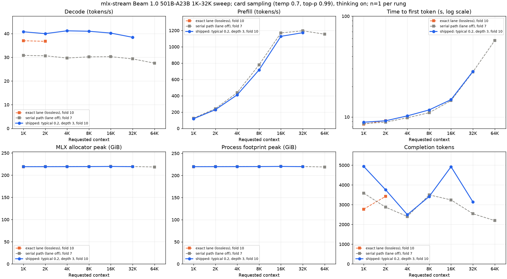
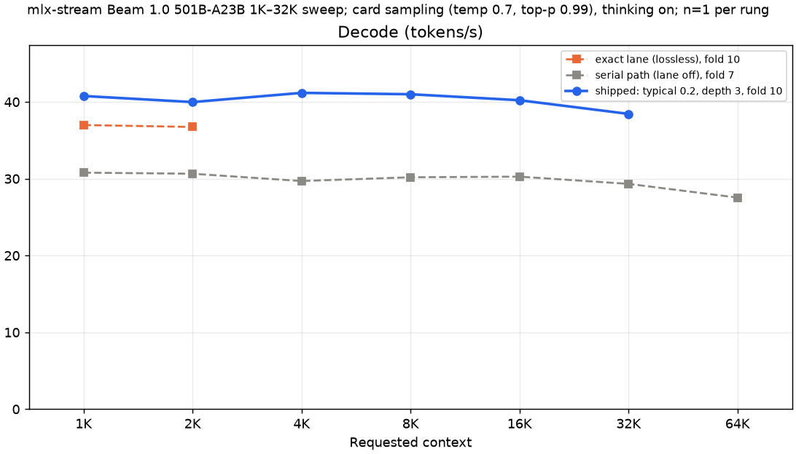
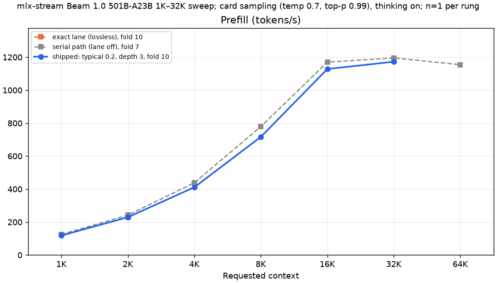
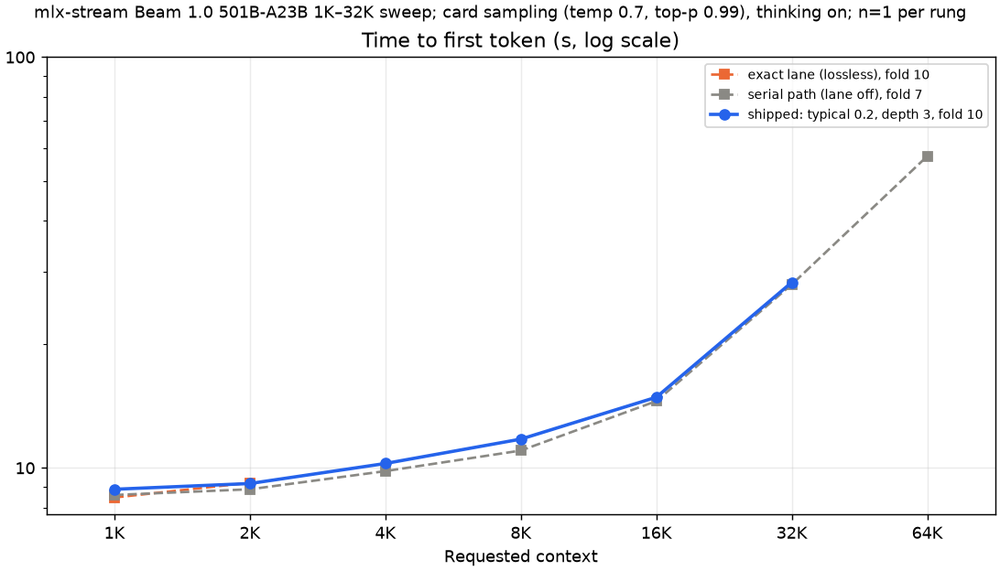
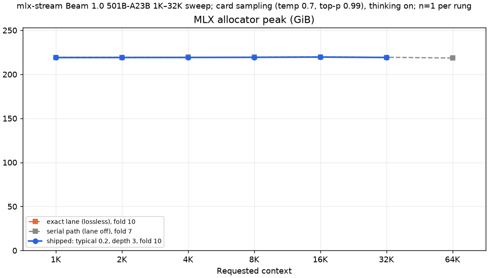
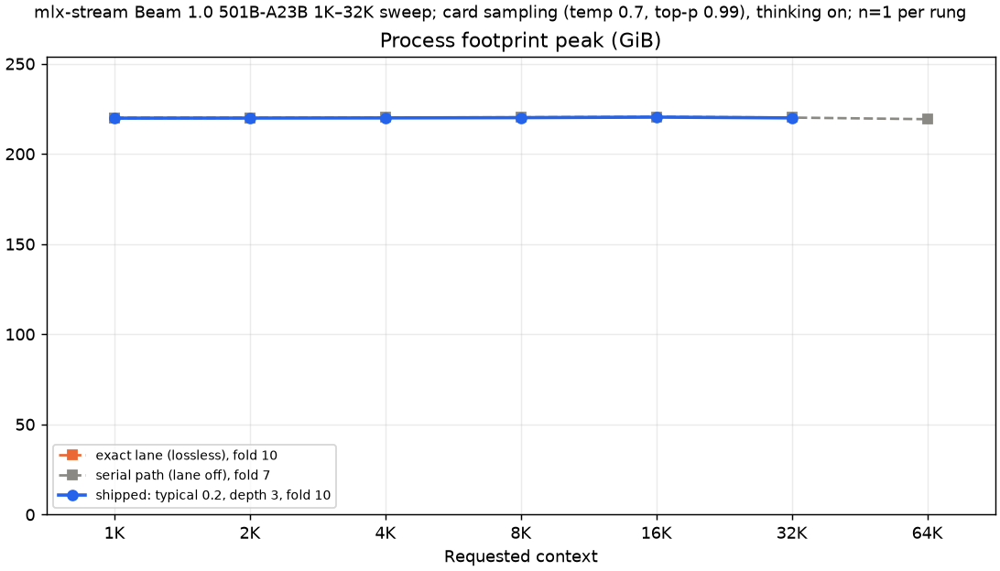
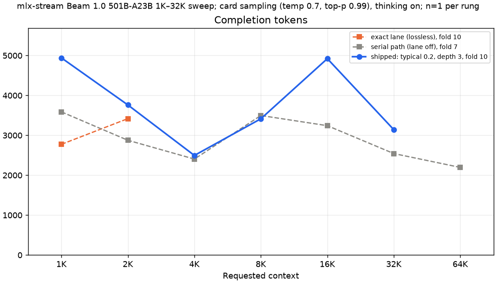

# Beam 1.0 501B-A23B on mlx-stream: benchmark record

This directory records Reflection's Beam 1.0 (501B-A23B, NVFP4 experts) on mlx-stream. It gives the context sweep
at the shipped rule (1K-32K), HumanEval pass@1, the serial path's sweep (1K-64K), the time to first token, and the
acceptance settings.
Every measurement is a fresh mlx-serve server on the Mac Studio M5 Ultra (256 GiB). Each load fills the prompt rows
from the pack's shipped expert-usage seed. The rows are pinned, so that the process stays near the 240 GB target.



At the shipped rule (the draft lane with `typical` acceptance at delta 0.2, depth 3), 193/203 rows, one request per
rung, card sampling:

| Requested context | Actual input | Rows P/D | Prefill (tok/s) | Decode (tok/s) | TTFT (s) | Tokens to EOS | Peak footprint (GB) | Least free RAM (GB) | Pageouts |
| ---: | ---: | ---: | ---: | ---: | ---: | ---: | ---: | ---: | ---: |
| 1K | 1,024 | 193/203 | 118.3 | 40.77 | 8.87 | 4,941 | 236.0 | 4.36 | 0 |
| 2K | 2,047 | 193/203 | 229.4 | 39.98 | 9.16 | 3,761 | 236.1 | 4.51 | 0 |
| 4K | 4,094 | 193/203 | 411.3 | 41.18 | 10.25 | 2,496 | 236.2 | 3.56 | 0 |
| 8K | 8,192 | 193/203 | 716.7 | 41.00 | 11.75 | 3,415 | 236.3 | 3.82 | 0 |
| 16K | 16,384 | 193/203 | 1,128.2 | 40.22 | 14.86 | 4,922 | 236.6 | 3.09 | 0 |
| 32K | 32,767 | 192/202 | 1,172.6 | 38.44 | 28.30 | 3,141 | 236.2 | 3.98 | 0 |

Decode is 38.4-41.2 tok/s from 1K to 32K, and prefill reaches 1,128.2 tok/s at 16K and 1,172.6 tok/s at 32K. Every run
stopped on EOS, stayed under its billed process bound, and paged nothing. The sweep stopped after 32K (David,
2026-10-19: "stop after the human eval"): the 64K-1M rungs were not run at the shipped rule. The serial path's record
goes to 64K ([The serial path](#the-serial-path-1k-64k-fold-7-mtp_lane-false)).

HumanEval greedy at the shipped rule: pass@1 0.9756 (160/164) by the score of record (rescore rule=last), 0.9634
(158/164) by the in-run scorer ([HumanEval](#humaneval)).

## The stacks

Two bundles give the numbers in this record. Both serve the q8 residents tier of
`Beam-1.0-501B-A23B-NVFP4-q8-mlx-stream` (NVFP4 experts, 277.5 GB, streamed from the internal SSD; q8 residents,
9.44 GB) with its shipped `expert-usage-v1.json` (explainer and prose traffic, never a benchmark prompt).

| Bundle | Server SHA-256 | Host | Plugin | Defaults | Measured here |
| :--- | :--- | :--- | :--- | :--- | :--- |
| `beam-stack-e6f48f0` | `dc1fcf185fbf8c8a3423847713c96c23968edad9f32bf82753f247d91cd70e39` | `feat/beam-tools` `0c1802e7` | `e6f48f0` (fold 10) | draft lane on, depth 3, the drafter's sidecar in the pack, 193/203 rows | the headline sweep at `typical` 0.2, 1K-32K; the exact lane at 1K and 2K; HumanEval greedy at `typical` 0.2 |
| `beam-stack-2769fbd` | `d3105d463da73000a6804cf191383f7bd6eb0f9e8531c22776dc36696e551213` | `feat/beam-tools` `0c1802e7` | `2769fbd` (fold 7) | draft lane off (`mtp_lane` false), 197/207 rows | HumanEval greedy and card on the serial path; the serial path's sweep, 1K-64K |

The shipped rule is the draft lane with `typical` acceptance at delta 0.2, depth 3, on the greedy draft path (see
[Acceptance settings](#acceptance-settings)). Fold 11 (`3d09b0d`, PR head `f3dfd14`) makes it the default in
`settings.zig`. The runs of this record are on the fold-10 bundle and name the rule in the host's model settings:
`{"mtp_lane":true,"draft_depth":3,"mtp_acceptance":"typical","mtp_typical_delta":0.2}` beside the rows. Two runs at
the fold-11 defaults (no rule named) give the same texts and the same rounds, bit for bit, as the fold-10 bundle with
the rule named ([docs/beam.md](../../beam.md#the-shipped-acceptance)). So these numbers stand for the PR head.

The `exact` rule is lossless. On a sampled request each emitted token has the target's distribution (exact rejection
sampling). On a greedy request a token can differ from the serial path's token at a near tie, because a 4-row verify
can round differently from a serial step.

Every server has these settings:

| Item | Value |
| :--- | :--- |
| GPU memory ceiling | 240 GiB (`MLX_SERVE_GPU_CEILING_MB=245760`) with `--wired-margin-gib 2`: a target of 255,550,554,112 B |
| Memory guard | the run stops before its request when the server's non-file baseline is over 27.5 GB |
| KV cache | BF16 (`--kv-quant off`); prefix cache off |
| Rows | pinned per run in the host's model settings (`expert_prefill_rows`, `expert_rows`); every prompt row seeded at load |
| Isolation | the machine's exclusive GPU lock and every build slot per run; the page cache of our trees evicted before each load |

```sh
MLX_SERVE_GPU_CEILING_MB=245760 mlx-serve --model <pack> --serve --port 11391 --ctx-size <served context> \
  --no-vision --no-warmup-eager --prefix-cache-entries 0 --metrics --log-file off --kv-quant off --wired-margin-gib 2
```

## Context sweep 1K-32K

### Matched serving configuration

Every rung used the same pack, server flags and request shape:

- the Mac Studio with an Apple M5 Ultra and 256 GiB (274.9 GB) of unified memory;
- bundle `beam-stack-e6f48f0`, the q8 pack with the drafter's sidecar and the shipped `expert-usage-v1.json`;
- the draft lane at the shipped rule, named in the host's model settings beside the rows:
  `{"mtp_lane":true,"draft_depth":3,"mtp_acceptance":"typical","mtp_typical_delta":0.2}`;
- card sampling: temperature 0.7, top-p 0.99 (the pack's `generation_config.json`; repetition penalty 1.0), seed 1, no
  top-k; thinking on (the template's default reasoning effort, `max`); `max_tokens` 16,384;
- a fresh server per rung, serving one request: `POST /v1/chat/completions`, streamed, with the fixture's user message.
  The server renders the pack's chat template;
- memory sampled every 2 s (least free RAM, pageouts).

The fixtures are the earlier context ladders' code corpus (`code-20260923`), fitted to Beam's tokenizer: each prompt is
the rung's nominal length (32K: 32,767 tokens). The served context (`--ctx-size`) is the prompt plus the 16,384-token
cap. The rows of each rung are the most rows whose bill at the served context stays under the control's process bound
(239,370,581,328 B at 193/203 and 32,768 positions). From 32K the KV takes rows. The bill at 32K is the greedy path's:
under `typical` the drafts take the greedy path, and the decode bill has no speculative verify rows (9,723,904 B less
than the `exact` lane's bill). Every prompt row is seeded at load. Each point is one request (n=1).

| Requested context | Actual input | Served context | Rows P/D | Billed process bound (GB) | Seeded prompt rows |
| ---: | ---: | ---: | ---: | ---: | ---: |
| 1K | 1,024 | 17,408 | 193/203 | 238.80 | 193 |
| 2K | 2,047 | 18,431 | 193/203 | 238.84 | 193 |
| 4K | 4,094 | 20,478 | 193/203 | 238.92 | 193 |
| 8K | 8,192 | 24,576 | 193/203 | 239.07 | 193 |
| 16K | 16,384 | 32,768 | 193/203 | 239.37 | 193 |
| 32K | 32,767 | 49,151 | 192/202 | 239.11 | 192 |

### Results

| Requested context | Actual input | Served context | Rows P/D | Prefill (tok/s) | Decode (tok/s) | TTFT (s) | Completion tokens | Finish | MLX peak (GiB) | Footprint peak (GiB) | Box peak (GB) |
| ---: | ---: | ---: | ---: | ---: | ---: | ---: | ---: | :--- | ---: | ---: | ---: |
| 1K | 1,024 | 17,408 | 193/203 | 118.3 | 40.77 | 8.87 | 4,941 | stop | 219.11 | 219.83 | 269.3 |
| 2K | 2,047 | 18,431 | 193/203 | 229.4 | 39.98 | 9.16 | 3,761 | stop | 219.15 | 219.88 | 269.1 |
| 4K | 4,094 | 20,478 | 193/203 | 411.3 | 41.18 | 10.25 | 2,496 | stop | 219.22 | 219.95 | 270.0 |
| 8K | 8,192 | 24,576 | 193/203 | 716.7 | 41.00 | 11.75 | 3,415 | stop | 219.36 | 220.09 | 269.8 |
| 16K | 16,384 | 32,768 | 193/203 | 1,128.2 | 40.22 | 14.86 | 4,922 | stop | 219.64 | 220.40 | 270.5 |
| 32K | 32,767 | 49,151 | 192/202 | 1,172.6 | 38.44 | 28.30 | 3,141 | stop | 219.19 | 219.95 | 269.6 |







The decode figure is the plugin's own (`beam decode:` line: tokens / decode wall). The lane emits 3.28-3.46 tokens a
round. Prefill and TTFT are the host's per-request line. A fixed cost of about 8 s is in the TTFT of every fresh
server's first request ([Time to first token](#time-to-first-token-where-the-prompt-pass-goes)), so prefill is low at
1K-8K and rises to its 16K-32K level.

### Memory

| Requested context | Rows P/D | Non-file baseline (GB) | Footprint peak (GB) | Least free RAM (GB) | Pageouts | SSD read a decode token (MB) | Expert hit rate (%) |
| ---: | ---: | ---: | ---: | ---: | ---: | ---: | ---: |
| 1K | 193/203 | 24.37 | 236.0 | 4.36 | 0 | 137.4 | 98.42 |
| 2K | 193/203 | 23.97 | 236.1 | 4.51 | 0 | 150.6 | 98.26 |
| 4K | 193/203 | 24.47 | 236.2 | 3.56 | 0 | 146.6 | 98.31 |
| 8K | 193/203 | 24.75 | 236.3 | 3.82 | 0 | 138.4 | 98.40 |
| 16K | 193/203 | 24.76 | 236.6 | 3.09 | 0 | 141.0 | 98.37 |
| 32K | 192/202 | 24.61 | 236.2 | 3.98 | 0 | 147.7 | 98.30 |







The process footprint peak (`/usr/bin/time -l`) is 236.0-236.6 GB, under each rung's bill. The whole machine peaked
at 269.1-270.5 GB of 274.9 GB, with at least 3.09 GB free and no pageouts.

### The exact lane beside the shipped rule

The lossless rule (`"mtp_acceptance":"exact"`, sampled drafts) on the same bundle and rows, 1K and 2K:

| Requested context | Actual input | Rows P/D | Prefill (tok/s) | Decode (tok/s) | TTFT (s) | Tokens to EOS | Peak footprint (GB) | Least free RAM (GB) | Pageouts |
| ---: | ---: | ---: | ---: | ---: | ---: | ---: | ---: | ---: | ---: |
| 1K | 1,024 | 193/203 | 124.1 | 36.99 | 8.47 | 2,775 | 236.0 | 3.30 | 0 |
| 2K | 2,047 | 193/203 | 228.4 | 36.74 | 9.20 | 3,419 | 236.1 | 4.02 | 0 |

At 1K and 2K the shipped rule decodes 10.2 % and 8.8 % faster than `exact`. The first `exact` runs of these two rungs
ran beside a file upload's reads and paged (2 pageouts each): they are not scored. Their reruns read the same token
counts.

## HumanEval

164 problems, one sample each, through the lab's pinned kit: the served19 incremental gate scores each completion as
it lands (the in-run scorer), and `rescore_humaneval.py` rule=last scores the prompt plus the last fenced block that
defines the entry point plus the test (the score of record). `classify.py` gives each failure one class. Greedy:
temperature 0, seed 0, thinking off, 8,192-token cap. Card: temperature 0.7, top_p 0.99, seed 1, thinking on,
16,384-token cap. Each arm is one fresh server, seeded, ctx 32,768, BF16 KV.

| Arm | Bundle | Draft lane | Rows P/D | pass@1, rescore rule=last | pass@1, in-run scorer | Failures | Decode median (tok/s) | Peak footprint (GB) | Least free RAM (GB) | Pageouts |
| :--- | :--- | :--- | ---: | ---: | ---: | :--- | ---: | ---: | ---: | ---: |
| **greedy, shipped rule** | `e6f48f0` | `typical` 0.2, depth 3 | 193/203 | **0.9756 (160/164)** | 0.9634 (158/164) | 4 wrong answers | 42.55 | 236.5 | 1.85 | 5 |
| greedy, serial record | `2769fbd` | off | 197/207 | 0.9817 (161/164) | 0.9634 (158/164) | 3 wrong answers | 29.20 | 236.8 | 5.94 | 0 |
| card, serial record | `2769fbd` | off | 197/207 | 0.9817 (161/164) | 0.9695 (159/164) | 3 wrong answers | 28.70 | 236.8 | 3.43 | 0 |

No arm has a truncation, a loop, a missing code block or a request error. Every request stopped on EOS. The failed
problems by the score of record: shipped rule 106, 116, 130 and 145; serial greedy 103, 106 and 116; card 92, 106 and
116. The shipped rule fails one problem more than the serial path's greedy run. One sample a problem cannot separate
the two.

The shipped-rule arm emits 2.74 tokens a round over 164 requests, and decodes at 43.83 tok/s in aggregate (the serial
greedy run: 30.26). The judge saw the `typical` 0.2 lane on 164 of 164 requests. The pinned judge's verdict is NO for both
greedy arms: a greedy request prints no sampler line, and the shipped-rule arm's lane is not the profile's `serial`. Memory was sampled every 10 s. The
shipped-rule arm paged 5 pages (least free RAM 1.85 GB); pass@1 does not depend on it. HumanEval at `exact` and at
delta 0.05 was not run (David, 2026-10-19).

## The serial path, 1K-64K (fold 7, `mtp_lane` false)

This record is the serial path (no draft lane) on bundle `beam-stack-2769fbd`, at the serial bill's rows (the most rows
under the control's bound of 239,502,242,236 B at 197/207 and 32,768 positions). The fixtures, sampling, seed and cap
are the headline's. The run stopped after 64K, when fold 9 turned the draft lane on by default. Memory was sampled
every 5 s (the fold-10 runs: every 2 s). `serial_results.json` holds the 7 rows.

| Requested context | Actual input | Rows P/D | Prefill (tok/s) | Decode (tok/s) | TTFT (s) | Tokens to EOS | Peak footprint (GB) | Least free RAM (GB) | Pageouts |
| ---: | ---: | ---: | ---: | ---: | ---: | ---: | ---: | ---: | ---: |
| 1K | 1,024 | 197/207 | 124.9 | 30.79 | 8.59 | 3,588 | 236.3 | 7.86 | 0 |
| 2K | 2,047 | 197/207 | 242.0 | 30.65 | 8.87 | 2,876 | 236.3 | 7.21 | 0 |
| 4K | 4,094 | 197/207 | 438.5 | 29.70 | 9.82 | 2,405 | 236.4 | 6.99 | 0 |
| 8K | 8,192 | 197/207 | 779.3 | 30.19 | 11.02 | 3,497 | 236.5 | 6.07 | 0 |
| 16K | 16,384 | 197/207 | 1,170.0 | 30.27 | 14.54 | 3,242 | 236.8 | 3.32 | 0 |
| 32K | 32,767 | 196/206 | 1,195.8 | 29.33 | 27.97 | 2,543 | 236.4 | 4.04 | 0 |
| 64K | 65,536 | 195/204 | 1,154.5 | 27.54 | 57.40 | 2,196 | 235.4 | 5.54 | 0 |

Every request stopped on EOS, with 0 pageouts.

## Time to first token: where the prompt pass goes

Two probes on a profile build (`09329f3`: the serial path at 197/207, seeded, seed 1234; diagnostic only, not for
merge) show the parts of the prompt pass. The numbers are from the build's GPU and drive timeline.

| Request | TTFT (s) | Prompt pass (ms) | Records read | SSD read (GB) | Drive busy (s) | Drive rate when busy (GB/s) | Reads in flight |
| :--- | ---: | ---: | ---: | ---: | ---: | ---: | ---: |
| 1K, first request of the process | 8.55 | 8,213.5 | 3,979 | 88.0 | 6.00 (73 %) | 14.67 | 3.98 |
| 1K, second request | 6.34 | 6,004.8 | 3,565 | 78.9 | 5.35 (89 %) | 14.75 | 3.98 |
| 16K, third request | 14.14 | 13,803.7 | 5,112 | 113.1 | 7.71 (56 %) | 14.67 | 3.97 |
| 16K, first request of the process | 16.16 | 15,801 | 5,040 | 111.6 | 7.64 (50 %) | 14.6 | 3.97 |

- The 1K prompt pass is drive-bound. The drive runs at its full rate, and the GPU is busy 1,494 ms of 7,846 ms (19 %).
  The prompt routes to 245 of 256 experts a layer, and the pass reads 3,979 records. The non-resident set is 2,891
  records: about 1,088 records (24 GB, 1.6 s) are evicted residents read again, or duplicates.
- The first request of a process costs 2.2 s more than the second: 0.66 s of drive time (414 more records) and 1.55 s of
  allocation and pipeline creation (2,181 new Metal buffers, 11.9 GB; 86 pipelines).
- The 16K prompt pass is 15,380 ms of timeline: GPU busy 10,248 ms and drive busy 7,639 ms, not fully in parallel. The
  GPU is idle 5,132 ms: the first-request stall in layer 0's attention 1,675 ms, MoE read waits 1,866 ms, host round
  trips at the routing barrier 1,085 ms (router 569, predict 516), and the tail 271 ms.
- The 16K prompt is two calls: 16,384 rows (13,934 ms, 4,258 records, 94.3 GB) and the last 61 rows (1,440 ms, 782
  records, 17.3 GB).

## Acceptance settings

The draft lane's rule (`mtp_acceptance`) decides which drafts the lane keeps. `exact` keeps a draft only when it is the
target's own token, so it is lossless. `typical` (`mtp_typical_delta`) also keeps a draft that the target gives enough
probability. It is lossy: a lower delta keeps more drafts, so it decodes faster and changes more tokens. The shipped
rule is `typical` at delta 0.2 (David, 2026-10-19). `{"mtp_acceptance":"exact"}` serves the lossless rule at the same
rows.

[docs/beam.md, The shipped acceptance](../../beam.md#the-shipped-acceptance) has the speed of `exact` and of `typical`
at 0.2, 0.1 and 0.05 on the coding workload, and each rule's fidelity over long texts. In short, on bundle
`beam-stack-e6f48f0` at 193/203 rows: decode 32.39 tok/s (`exact`), 37.98 (0.2), 39.01 (0.1) and 40.69 (0.05), the
mean of two seeds; top-1 agreement with the serial model 98.78 %, 87.39 %, 87.17 % and 84.64 %. This page adds the
`exact` lane's 1K and 2K beside the shipped rule's sweep, and HumanEval at the shipped rule.

## Provenance and receipts

- Runs: mac-studio-m5u, 2026-10-18 and 2026-10-19 (PDT). The serial record: 2026-10-18 17:53-22:35. The exact
  lane's 1K and 2K: 2026-10-19 08:37-09:15. The headline 1K-32K: 2026-10-19 08:35-09:40, between other jobs in the
  machine's GPU queue. HumanEval: the serial greedy arm
  2026-10-18 17:45-19:08, the card arm 22:00-00:47, the shipped-rule arm 2026-10-19 09:40-10:10.
- Run dirs: `~/beam/eval/sweep/runs/sweep-<rung>-<tag>` on the box (tags `typ02-e6f48f0-240`, `e6f48f0-240`,
  `2769fbd-240`), outside this repository. Each holds the arm (`arm.env`), the request (`workload.json`), the client's
  receipt (`client.json`), the server log (`serve.log`), the memory samples (`memory.tsv`) and the run's numbers
  (`run.json`). The JSON files here name each row's run dir and the SHA-256 of its receipt, request, prompt, server
  log and output.
- Every rung's check (`sweep_check.py`): the prompt is the fixture's count, the rows are the arm's and forced, the
  reserve is the served context, every prompt row was seeded from the pack's `expert-usage-v1.json`, and the server's
  process bound is the plan's within 1 MB (every run: 272 B under).
- `python3 scripts/beam_sweep_charts.py --cells-root <run dirs>` rebuilds `results.json`, `exact_results.json` and
  `serial_results.json` from the run dirs. It checks each run against the server's own lines (the host's per-request
  line, the arch's memory, decode, seed and draft-lane lines, the sampler's bind line and the request's POST line).
  Without `--cells-root` it draws the PNGs from the JSON files; `--tables` prints this page's tables. The charts
  share `scripts/sweep_charts.py` with the MiMo record.
- HumanEval: the lab's pinned kit (`HumanEval.jsonl` SHA-256 `1d49078b...`, the served19 incremental gate, the
  adapter, `rescore_humaneval.py`, the judge and `classify.py`). Run dirs `~/beam/eval/he/runs/he-<arm>-<tag>` on the
  box.
