# GLM-5.3-Flash on mlx-stream: benchmark record

This directory records the GLM-5.3-Flash (`glm5_next`) serving stacks measured on 2026-10-14 and the night of 10-14/15.
The stacks of record are now **g25-dsa3** (exact) and **g26-dsa3** (rounding-class: g25-dsa3's twin with a q8 draft head).
Both carry the DSA lane-copy fixes (see [The DSA lane-copy finding](#the-dsa-lane-copy-finding)) on top of the day's
stacks **g25b** and **g26**, which this record keeps as the controls they were measured against. It gives the stacks' rows
ladders, every lever pair with its verdict, how the numbers were measured, the serve recipe and what did not work.

| Stack | Plugin | Server SHA-256 | Class | 190/217 decode / prefill | Headline (rows) decode / prefill |
| --- | --- | --- | --- | ---: | ---: |
| **g25-dsa3** | `glm5next/exl3-k3-stack3-dsalane` `0457394` | `6481fa1b` | exact | not measured alone (see g25-dsa) | 34.50 / 1,077.1 (199/225) |
| g25-dsa | `glm5next/exl3-k3-stack3-dsalane` `88d2aad` | `5bbd8512` | exact | 33.15 / 1,093.5 | 34.10 / 1,084.3 (199/225) |
| **g26-dsa3** | `glm5next/exl3-k3-dsalane` `cf30601` | `de1ab1f6` | rounding-class | 34.95 / 1,093.0 | 36.30 / 1,086.0 (199/225); 35.70 / 1,085.4 (197/223) |
| g25b | `glm5next/exl3-k3-stack3` `f8465ad` | `3514568e` | exact | 32.80 / 1,093.3 | 33.80 / 1,083.7 (199/225) |
| g26 | `glm5next/exl3-k3-stack4` `9bf67a7` | `087434fe` | rounding-class | 34.55 / 1,092.8 | 35.60 / 1,085.9 (199/225) |

All servers are host `glm5next/host` `a8f6c6b8` with the plugin above, built ReleaseFast. Against the 40 tok/s decode /
1,000 tok/s prefill goal, prefill is met on every stack. Decode reaches 34.50 on the exact stacks (86 % of the goal,
g25-dsa3 at 199/225) and 36.30 on the q8 stacks (91 %, g26-dsa3 at 199/225).

g25-dsa3 is g25-dsa plus the MTP head's side rows. That lever measured +2.79 % on the q8 stack with the tail fix included
(g26bin-vs-dsa3) against g26-dsa2's +1.61 % for the tail fix alone (g26bin-vs-dsa2, a different window): about +0.4 % for the side rows; it is exact and was stacked without its own exact
pair (small exact positives stack, judged by the stack's next pair).

Which stack is the headline is a policy choice:

- **g25-dsa3** (exact): every token id equals the serial path's at equal rows. Choose it when the headline must be exact.
- **g26-dsa3** (rounding-class): the q8 head changes which drafts the lane offers, so ids diverge from the exact stack
  (first at token 872 of the 1,024-token cell on g26). It passed the three-fixture grader battery 3/3, where the exact
  control failed the code fixture on the same single sample.

On branch `feat/glm53-flash-exl3`, the defaults are the exact stack g25-dsa3. Add `"draft_head": "q8"` to get the
g26-dsa3 head. The stack names in this record are the lab builds that gave the numbers.

## The stacks of record (2026-10-15)

**g25-dsa3** (exact), `glm5next/exl3-k3-stack3-dsalane` at `0457394`, server
`6481fa1b07932a2aa215895b2431f611908975e22d612c4e903181fe41067ba5`. Commits over g25b (`f8465ad`), each cherry-picked
from the q8 branch `glm5next/exl3-k3-dsalane` without the q8 head's hunks:

- `4fcfc92` (from `c063864`): the index lane's append in place (the pooled-keys text reads the lane buffer; the gate cast
  and the row concatenation folded into that text) and `dsa_split_form` with `lean` the default (bit for bit the current
  split; it measured a wash, see the lever table);
- `88d2aad` (from `2cee232`): the 16-row stored tail beside each DSA lane, which the pooled-keys text reads, so the trunk's
  lane appends are donated (in place) in decode;
- `0457394` (from `cf30601`): the MTP head's side rows. A round's draft steps past the first keep their latent and index
  rows in a per-round side buffer (`dsa.Side`) instead of appending to the head's lanes. The side-aware scores and split
  texts read the lane rows, then the side rows: the same keys in the same order.

Bill identical to g25b (0 B); rows 190/217 at 12.6 GB.

**g26-dsa3** (rounding-class), `glm5next/exl3-k3-dsalane` at `cf30601`, server
`de1ab1f6bdd65ce60e84e4ca3aee84fb6e5ffe9a9641e1a32dce2096cc7ca3ff`: g26 (`9bf67a7`) + `c063864` + `2cee232` + `cf30601`
(the same three changes, on the q8 stack). Bill identical to g26: the q8 head's `mtp_head_q8` term, so its pins admit
0.68 GB less baseline than the exact stack's.

## The DSA lane-copy finding

The DSA layers append each step's latent and index rows to preallocated lanes, a slice update that MLX performs in
place only when nothing else holds the lane buffer (`lib/mlx-src/mlx/backend/metal/utils.h:218-223`,
`primitives.cpp:128-133`). MLX keeps a reference to every input of an encoded GPU op until its command buffer completes
(`metal/eval.cpp:47-67`). The pooled-keys text reads the index lane in the same forward, still in flight at the append,
so the append copied the whole lane: 32,768 × 512 B = 16.8 MB read and written per DSA layer per forward. The latent lane
copied too (in place on 3 of 11 layers), and the MTP head's lanes copied at every draft step, because the draft chain
runs a round's steps in one graph.

The first fix (`c063864`: the text reads the lane by offset) did not engage on the device: its probe printed
`append=copy` (batch 45, INVALID on engagement; see the lever table). The holder is the in-flight read itself, which a
view's lifetime does not cover. The fixes that engaged:

- **Stored tails** (`2cee232`): a 16-row tail beside each lane holds the pool's newest rows, and the pooled-keys text
  reads the tail instead of the lane. Same stored values: exact.
- **Side rows for the MTP head** (`cf30601`): see the stack list above. Exact (CPU emulator bit-identical; the trunk
  scores text unchanged by sha).

Engagement is visible in two places:
- a construction probe line, `glm5_next dsa index lane: append=in_place|copy`;
- the request-end tally line, per lane group and phase: `glm5_next dsa lanes over the request (in place = the buffer
  kept): trunk whole latent=a/11 index=b/11; trunk decode latent=c/11 index=d/11; mtp_head whole latent=... index=...;
  mtp_head decode latent=... index=...`.

The window probe (batch 46, g26-dsa2) read decode latent and index in place 11/11. The prompt pass still copies: the
whole-request tally reads 2/11 latent and 0/11 index, because span N+1's append meets span N's reads in flight in the
layer-major prompt pass. That costs about 30 ms per 16K prompt; not fixed.

## The stacks of 2026-10-14

**g25b**, `glm5next/exl3-k3-stack3` at `f8465ad`, server `3514568e20cb4d3bc4cf9b0e2fae88c4df988d2201baf09cdf0c53a11df1e2a5`.
Each item below is an exact construction-time route, on by default (the old value stays settable by key):

- EXL3 K=3 decode forms `exl3_gateup_form` `guone` + `exl3_down_form` `pair` (`dc0016c`);
- the prompt-wave bundle: `exl3_wave_rows` 2,048, `prompt_route_cut` on, `prompt_static_order` sampled, `ttft_tail`
  deferred (`55e814f`);
- typical acceptance merged, off by default (`mtp_acceptance` `exact`; `typical` settable);
- direct miss reads `miss_reads` `direct`: demand reads land straight in the slot rows, with the record and row
  alignment checked at construction (`6b20b8a`);
- the fused KDA verify `kda_verify` `fused`: the MTP verify's KDA layer in one dispatch per layer (`82e8354`);
- the five trunk launch fusions (`fuse_kda_inputs`, `fuse_gate_up`, `fuse_predictor`, `fuse_join`, `merge_gate_waits`)
  and the construction-time pipeline pre-build. The pre-build covers the decode lane's kernels at widths 1–4, the EXL3
  prompt waves at 2,048 and 1 rows, and the decode chain at every width (`660577d`, `2e144d1`);
- the batched DSA selection `dsa_select` `batched`: a verify window's indexer scores and top-k in one launch each
  (`380bfc7`, default `3dc224b`);
- `hit_wave` `all_pairs` (`resident_only` is settable; it measured negative, see the lever table).

**g26**, `glm5next/exl3-k3-stack4` at `9bf67a7`, server `087434fea796de167a3aec630aeead7eb1b40d5b771eee9e922ff68d183896a9`:
g25b plus the drafthead lane's q4 / q8 draft heads (`a1efb11`, from `601f230`, `f5fb02c`, `4f98d6a`), with
`draft_head` `q8` by default (`9bf67a7`). The draft steps read an 8-bit affine copy of `lm_head` (group 64, MLX's
`quantized_matmul`) and draw through a top-256 filter. The verify keeps the BF16 head and draws every emitted token from
its full row. The q8 copy is billed as `mtp_head_q8`: 674,037,760 B, +675,111,456 B fixed with its wiring. `bf16` and
`q4` stay settable.

## Rows ladders

The expert stream holds a fixed number of slot rows per routed layer (prompt rows / decode rows), pinned per run in the
pack's settings block. More decode rows mean fewer expert misses per token and less read-wait, at about 398 MB per
decode row. Each rung below is the same 16K/1K cell at a higher pin. The 217–221 rungs are the B arms of ABBA rows pairs
against a 190/217 control; the 225 rung is a single first-step cell (see the method).

### g25b (exact)

| Rows P/D | Decode (tok/s) | Prefill (tok/s) | Peak footprint (GB) | Arms | Pin admits up to (GB) |
| ---: | ---: | ---: | ---: | ---: | ---: |
| 190/217 | 32.80 | 1,093.3 | 104.20 | 2 | 12.69 |
| 193/219 | 33.15 | 1,089.0 | 104.99 | 2 | 11.69 |
| 195/221 | 33.35 | 1,091.0 | 105.79 | 2 | 10.89 |
| 199/225 | 33.80 | 1,083.7 | 107.38 | 1 | 9.30 |

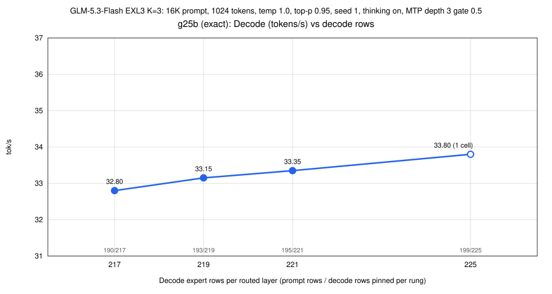

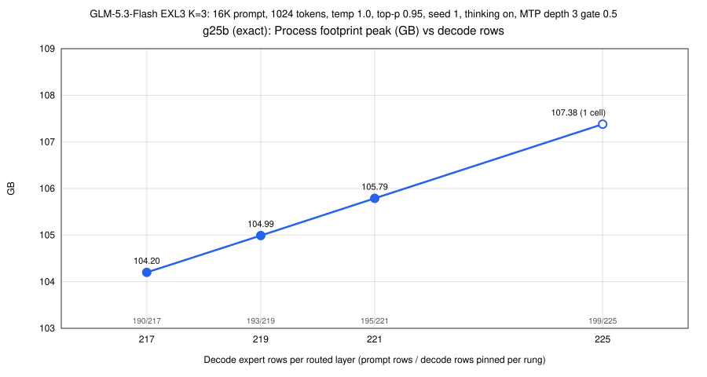

### g26 (q8 draft head, rounding-class)

| Rows P/D | Decode (tok/s) | Prefill (tok/s) | Peak footprint (GB) | Arms | Pin admits up to (GB) |
| ---: | ---: | ---: | ---: | ---: | ---: |
| 190/217 | 34.55 | 1,092.8 | 104.87 | 2 | 12.01 |
| 193/219 | 34.85 | 1,092.0 | 105.67 | 2 | 11.01 |
| 195/221 | 35.05 | 1,092.0 | 106.54 | 2 | 10.22 |
| 199/225 | 35.60 | 1,085.9 | 108.05 | 1 | 8.62 |

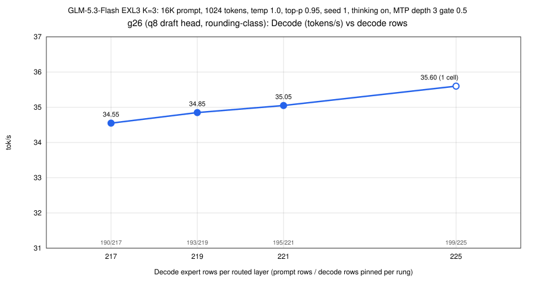

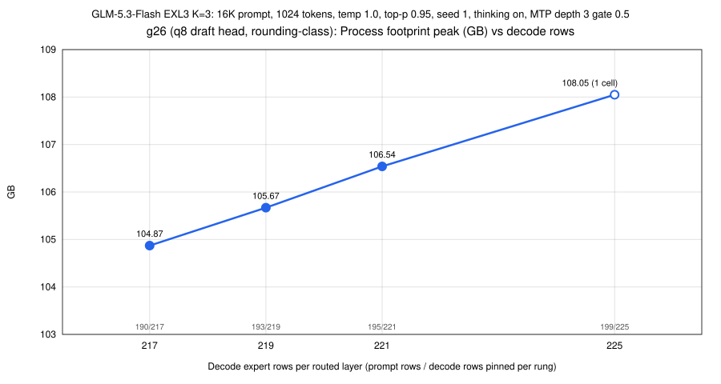

Decode rises about 0.4–0.5 % per decode row on both stacks (217 → 225: +3.0 % on each). The rows pairs are VALID beyond noise on both stacks:
g25b +1.07 % (193/219) and +1.83 % (195/221); g26 +0.87 % and +1.74 %. The 225 rung matches the residency replay's
model (16.74 misses per token at 217, 14.27 at 225). Prefill is flat across the ladder. The peak footprint grows by the
billed rows: +0.79 GB per two decode rows, and q8 adds its +0.67 GB at every rung.

"Pin admits up to" is the box baseline (physical memory in use before the load) under which the memory bill admits the
pin: the bill's fill at that baseline reaches the pinned rows. It is the margin a deployment needs, not a measurement of
the run.

Prefill at 190/217 is from the stack's own head-to-head pair (g24bin-vs-g25 and g25bin-vs-g26 B arms, two arms each).
The rows pairs' A arms give the 190/217 decode. The 225 cells and the peak footprint are the process's lifetime peak
physical footprint, in decimal GB (10^9 B).

### g25-dsa (exact, DSA lane fix) and g25-dsa3

| Rows P/D | Decode (tok/s) | Prefill (tok/s) | Peak footprint (GB) | Arms | Pin admits up to (GB) |
| ---: | ---: | ---: | ---: | ---: | ---: |
| 190/217 | 33.15 | 1,093.5 | 104.21 | 2 | 12.69 |
| 199/225 | 34.10 | 1,084.3 | 107.40 | 1 | 9.30 |
| g25-dsa3 199/225 | 34.50 | 1,077.1 | 107.40 | 1 | 9.30 |

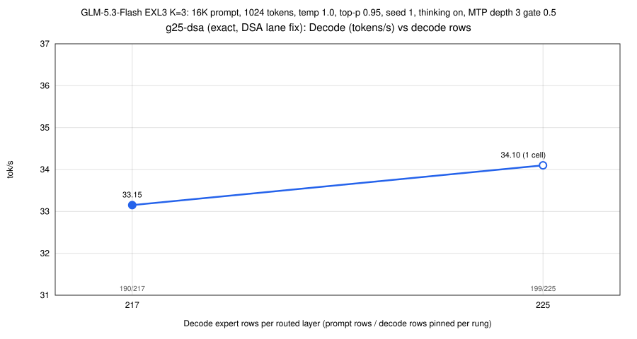

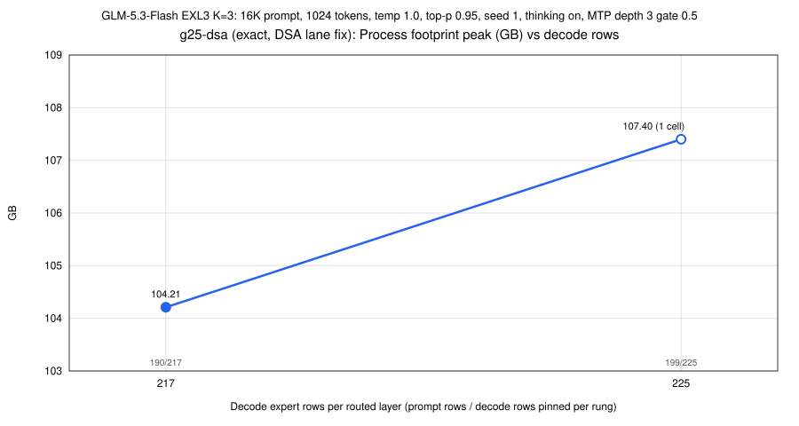

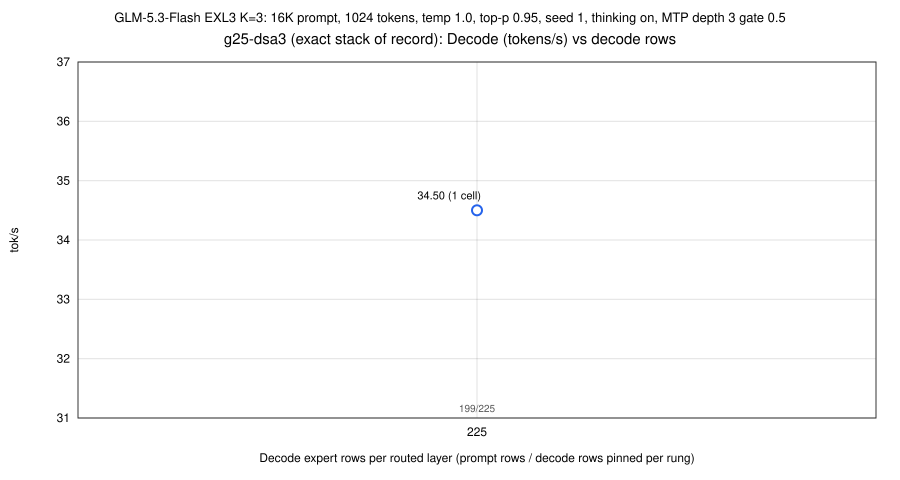

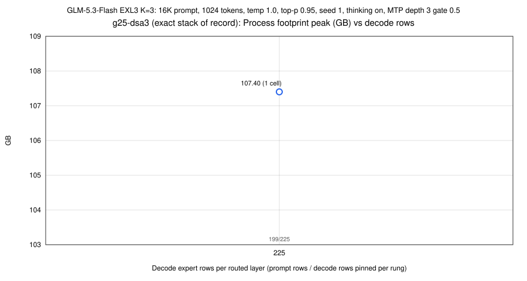

### g26-dsa3 (q8 draft head + DSA lane fixes, rounding-class)

| Rows P/D | Decode (tok/s) | Prefill (tok/s) | Peak footprint (GB) | Arms | Pin admits up to (GB) |
| ---: | ---: | ---: | ---: | ---: | ---: |
| 190/217 | 34.95 | 1,093.0 | 104.88 | 2 | 12.01 |
| 197/223 | 35.70 | 1,085.4 | 107.28 | 1 | 9.42 |
| 199/225 | 36.30 | 1,086.0 | 108.07 | 1 | 8.62 |

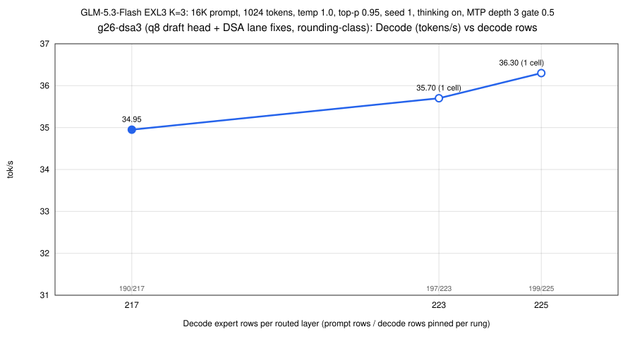

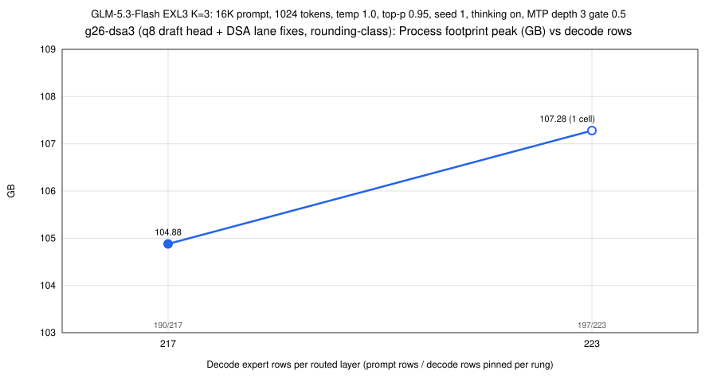

The 190/217 rung of each new ladder is the B arms of the stack's head-to-head pair (g25bin-vs-g25dsa, g26bin-vs-dsa3).
The upper rungs are first-step headline cells, flagged OVERFILL like the 225 cells above: 1.23 GB over the fill at load
for g25-dsa at 199/225, 0.9 GB for g26-dsa3 at 197/223, and 1.65 GB for g26-dsa3 at 199/225 (batch 54b, the clean-wait
headline: 7.52 GB after the pulse, gate ADMIT at 7.86). g25-dsa3 at 199/225 (batch 53, the clean-wait headline: 7.75 GB
after the pulse, gate ADMIT at 8.19, OVERFILL 1.17 GB at load) has its own one-point chart. It is not a rung of g25-dsa's
ladder, because the side rows add a lever: 34.50 against g25-dsa's 34.10 at the same pin, a single cell each in
different windows.

## Context sweep 1K-1M

One request per context rung, from 1K to 1M prompt tokens, on the exact stack of this branch (the g25-dsa3 kernels and
defaults). The server is the real mlx-serve binary through its `/v1/completions` endpoint, not an in-process cell.

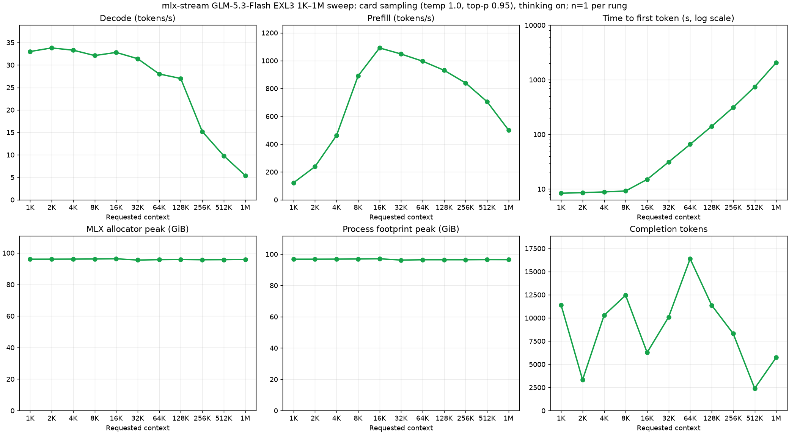

### Matched serving configuration

Every rung used the same pack, server flags and request shape:

- Apple M5 Max with 128 GB of unified memory, GPU fans at full, no other model server loaded, each server run
  serialized by the machine's exclusive GPU lock and watched by the memory guard;
- server build g28-clean, SHA-256 `e20b4548ef9212b4db278432b2d213ff7305d4c90ee7a3af80a83498d75fe7cd`: host
  `glm5next/host` `a8f6c6b8` with this branch's plugin at `6ac6dbf`, ReleaseFast;
- pack `GLM-5.3-Flash-EXL3-K3-fp8res-mlx-stream`: EXL3 K=3 experts streamed from the internal SSD, FP8 residents,
  NVFP4 MTP bank;
- GPU memory ceiling 112 GiB (`MLX_SERVE_GPU_CEILING_MB=114688`) with `--wired-margin-gib 2`;
- 16-bit KV cache (BF16, `--kv-quant off`), prefix cache off;
- the MTP draft lane on (`"enable_mtp": true`) with `draft_depth` 3 and `draft_gate` 0.5;
- card sampling: temperature 1.0, top-p 0.95, seed 1, no top-k; thinking on; `max_tokens` 16,384;
- a fresh server per rung, serving one request: `POST /v1/completions` with the prompt rendered by the pack's chat
  template.

```sh
MLX_SERVE_GPU_CEILING_MB=114688 nice -n 19 mlx-serve serve --model <pack> \
  --host 127.0.0.1 --port 8081 --ctx-size <served context> --timeout 0 \
  --no-vision --no-warmup-eager --prefix-cache-entries 0 --metrics \
  --log-file off --kv-quant off --wired-margin-gib 2
```

The served context (`--ctx-size`) is the prompt plus the 16,384-token cap. The 1M fixture is 1,032,192 tokens, so that
its served context is the model's 1,048,576-token limit. Actual input is the server's prompt count: with thinking on
the request drops the fixture's trailing `</think>`, one token.

Expert rows (slot rows per routed layer, prompt phase / decode phase) were pinned per rung in the pack's `config.json`
at the memory bill's fill for a 12.6 GB box baseline. Every pin passed the layer-rows check and held at load. The rows
fall with context as the bill gives memory to the KV.

The two commits after `6ac6dbf` on this branch (`1fbe7d1`, `1f3a3c0`) change only the expert stream's slot-array
allocation floor and its refusal path, not the kernels or the numbers.
Identity pair (2026-10-15, 16K/1K standard cell, 190/217, control / candidate / candidate / control): g28-clean (6ac6dbf) 1,093.5 prefill / 32.90 decode vs g29-clean (1f3a3c0) 1,094.8 / 33.25; prefill +0.11 % and decode +1.06 %, both within noise; the 1,024 output ids are identical in all four arms. The two commits do not change the kernels or the numbers.

Every point is one request (n=1), with no uncertainty interval. `sweep_results.json` holds the 11 rows.

### Results

| Requested context | Actual input | Served context | Rows P/D | Prefill (tok/s) | Decode (tok/s) | TTFT (s) | Completion tokens | Finish | MLX peak (GiB) | Footprint peak (GiB) | Box peak (GB) |
| ---: | ---: | ---: | ---: | ---: | ---: | ---: | ---: | :--- | ---: | ---: | ---: |
| 1K | 1,023 | 17,408 | 191/217 | 122.0 | 33.0 | 8.39 | 11,410 | stop | 96.06 | 96.79 | 112.6 |
| 2K | 2,047 | 18,432 | 191/217 | 238.4 | 33.8 | 8.59 | 3,324 | stop | 96.08 | 96.80 | 113.1 |
| 4K | 4,095 | 20,480 | 191/217 | 462.2 | 33.3 | 8.86 | 10,278 | stop | 96.12 | 96.84 | 112.8 |
| 8K | 8,191 | 24,576 | 191/217 | 889.4 | 32.1 | 9.21 | 12,446 | stop | 96.19 | 96.91 | 114.1 |
| 16K | 16,381 | 32,766 | 190/217 | 1,091.5 | 32.8 | 15.01 | 6,263 | stop | 96.33 | 97.06 | 113.6 |
| 32K | 32,766 | 49,151 | 189/214 | 1,047.8 | 31.4 | 31.27 | 10,099 | stop | 95.51 | 96.23 | 112.9 |
| 64K | 65,534 | 81,919 | 188/213 | 996.2 | 28.0 | 65.78 | 16,384 | length | 95.76 | 96.43 | 112.9 |
| 128K | 131,071 | 147,456 | 185/210 | 930.6 | 27.0 | 140.85 | 11,373 | stop | 95.86 | 96.43 | 113.1 |
| 256K | 262,143 | 278,528 | 178/203 | 839.5 | 15.2 | 312.26 | 8,314 | stop | 95.69 | 96.43 | 113.3 |
| 512K | 524,287 | 540,672 | 161/190 | 704.7 | 9.8 | 743.99 | 2,397 | stop | 95.74 | 96.51 | 113.1 |
| 1M | 1,032,191 | 1,048,576 | 128/165 | 500.4 | 5.4 | 2,062.73 | 5,732 | stop | 95.93 | 96.48 | 113.9 |

### Decode

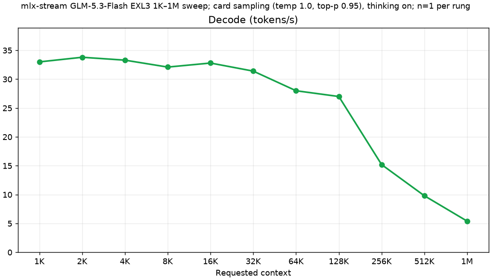

Decode holds 31.4-33.8 tok/s from 1K to 32K and reads 27-28 tok/s at 64K-128K. It then drops to 15.2 tok/s at 256K,
9.8 at 512K and 5.4 at 1M. Over that range the pinned expert rows shrink (217 decode rows at 1K, 165 at 1M), and the
attention and indexer work per token grows with the keys.

### Prefill

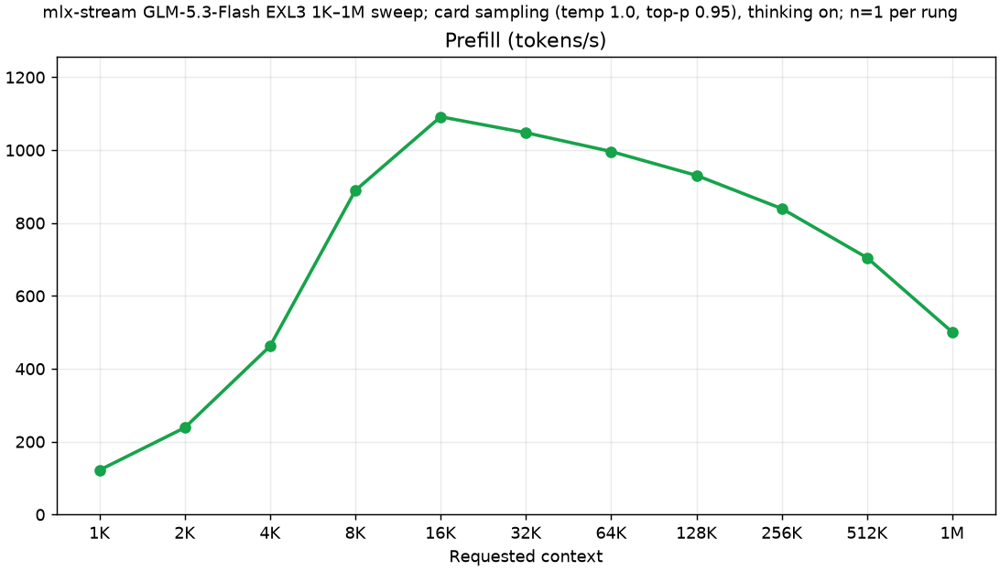

Prefill peaks at 16K (1,091.5 tok/s) and falls to 500.4 tok/s at 1M. Below 16K a fixed cost of about 8 s per first
request dominates the TTFT, so the rate rises with the prompt.

The standard 16K/1K headline cells of the same stack (the stack table above) use `max_tokens` 1,024 and other pins; the
16K rung here is a separate request and does not replace them.

### Time to first token

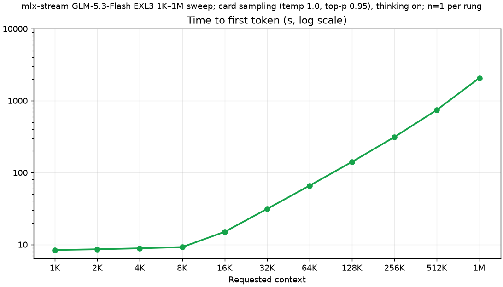

TTFT is prompt tokens / the server's prefill rate, from the server's per-request line. The 1M rung's 1,032,191-token
prompt takes 2,062.7 s (34 min).

### Memory

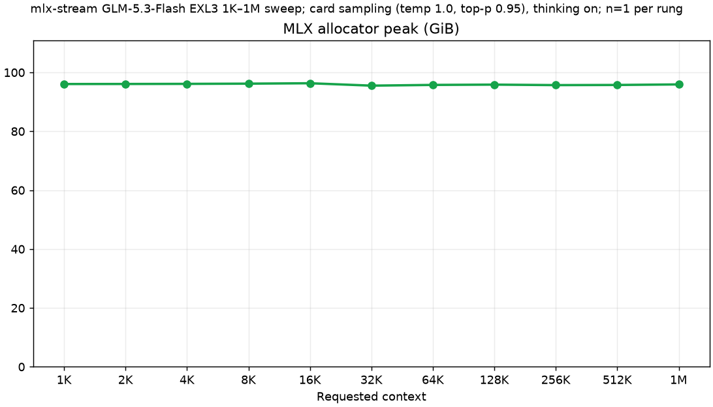

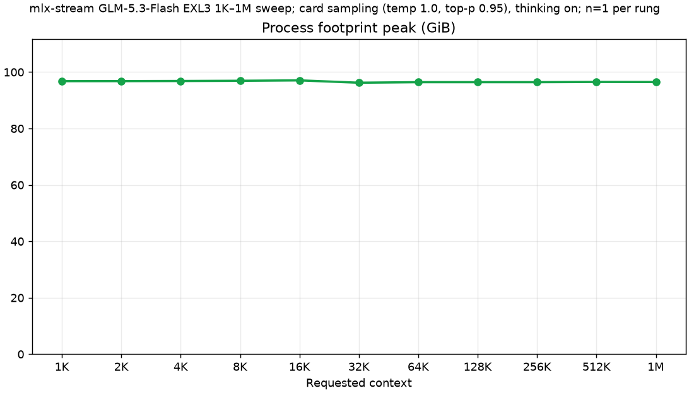

The MLX allocator peak stayed at 95.5-96.3 GiB and the process footprint peak at 96.2-97.1 GiB on every rung: the bill
gives the KV's growth back from the expert rows. The two peaks have different scopes and must not be added. The whole
machine peaked at 112.6-114.1 GB. The box baseline at load was 10.4-11.0 GB, under the 12.6 GB that the pins assume.

### Completion tokens

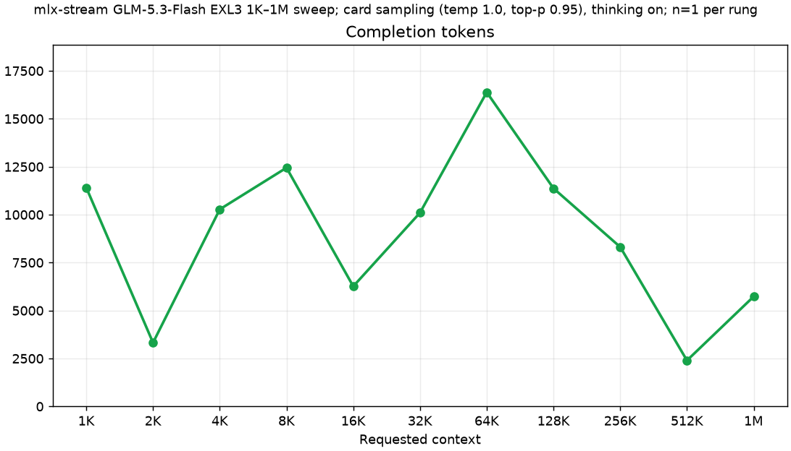

The 64K rung hit the 16,384-token output cap (`finish_reason: length`). Every other rung stopped on EOS
(`finish_reason: stop`) after 2,397-12,446 tokens.

### Provenance

- Cells: the 11 ladder cells of 2026-10-15 in the lab's `reports/dsv41-f39-tcq3-runtime/mimo/cells`
  (`glm5next-ladder-<rung>-20261015`, run dirs `rNN-<rung>-clean`), outside this repository. Each cell holds the
  receipt (server command, environment, request body, numbers), the request, the response, the server log and the
  output. `sweep_results.json` names each row's cell and the SHA-256 of its receipt, prompt and output.
- The binary of the sweep is g28-clean, SHA-256 `e20b4548` (`binary_sha256`), built from host `a8f6c6b8` and plugin
  `6ac6dbf` (`plugin_commit`).
- Prefill and decode are the server's own per-request line. The chart script is `ladder_results.py`
  (`--suffix=-clean --binary e20b4548`) beside the cells, not in this repository. It writes the results file and the
  line charts.

## Lever pairs, 2026-10-14

Each pair is one ABBA window (control, lever, lever, control), lane on, both arms at 190/217 with the standard MTP block,
unless the row says otherwise. Deltas are B vs A arm means: raw decode, and clock-corrected (cc) where the verdict
computed it. "Beyond" means outside both arms' spreads, "within" inside them; NOISY means one arm's two cells
disagreed by more than the cap. Exact means token ids identical across all four arms.

| Lever | Pair | Stack | Decode A → B | Δ decode | Δ prefill | ids | Verdict | Disposition |
| --- | --- | --- | --- | ---: | ---: | --- | --- | --- |
| Typical acceptance δ 0.3 | g22-exl3t-vs-tv-d03 | g22-exl3t | 30.60 → 30.05 | −1.80 % beyond | within | diverge (by design) | VALID | dead |
| Typical acceptance δ 0.5 | g22-exl3t-vs-tv-d05 | g22-exl3t | 30.75 → 31.15 | +1.30 % beyond | within | diverge | VALID | failed its battery (2 of 3 fixtures the exact control passes); merged, off |
| Typical acceptance δ 0.7 | g22-exl3t-vs-tv-d07 | g22-exl3t | 30.90 → 31.20 | +0.97 % beyond | within | diverge | VALID | not stacked (0.5 picked for the battery) |
| Forms guone + pair | g22-exl3b-vs-guone-pair | g22-exl3b | 30.70 → 31.25 | +1.79 % beyond | within | exact | VALID | stacked (default) |
| Forms gemv_u8 + pair | g22-exl3b-vs-u8-pair | g22-exl3b | 30.45 → 30.65 | +0.66 % within | within | exact | VALID | superseded by guone |
| Prompt-wave bundle | g22-pw-vs-all | g22-pw | prefill 1,010.2 → 1,072.7 | within | **+6.18 % beyond** | exact | VALID | stacked (default) |
| 4,096-row waves alone | g22-pw-vs-w4096 | g22-pw | prefill 1,006.6 → 1,025.8 | within | +1.91 % beyond | exact | VALID | not stacked (the 2,048 bundle is larger) |
| q4 draft head | g22-dh-vs-q4 | g22-dh | 30.75 → 30.15 | −1.95 % beyond | within | diverge | VALID | dead (drafts less accepted) |
| Launch fusions, all five | g22-lf-vs-all | g22-lf | 30.30 → 30.85 | +1.82 % beyond | −0.21 % | exact | VALID | warm-up artifact (see g23-vs-g24) |
| KDA-input fusion alone | g22-lf-vs-kin | g22-lf | 30.75 → 30.85 | +0.33 % within | within | exact | VALID | wash |
| Direct miss reads | g22-dr-vs-direct | g22-dr | 31.10 → 32.00 | +2.89 % beyond | +1.82 % beyond | exact | VALID | stacked (default) |
| Decode-set seeding + 6 workers | g22-ws-vs-both | g22-ws | 31.30 → 31.80 | +1.60 % beyond (cc +1.68 %) | −0.75 % beyond | exact | VALID | not reproduced by its singles; parked |
| Seeding alone | g22-ws-vs-seed | g22-ws | 31.40 → 31.55 | +0.48 % within | −0.86 % beyond | exact | VALID | not stacked |
| Six demand workers alone | g22-ws-vs-w6 | g22-ws | 31.40 → 31.25 | −0.48 % within | within | exact | VALID | wash |
| guone_pair gate/up form | g23-vs-guone-pair | g22-gp | 31.25 → 31.15 | −0.32 % within | within | exact | VALID | dead |
| Fused KDA verify | g23-vs-kda-fused | g22-kf | 31.15 → 31.55 | +1.28 % beyond (cc +1.29 %) | within | exact | VALID | stacked (default) |
| Draft chain once + deferred | g22-dc-vs-both | g22-dc | 31.45 → 31.35 | −0.32 % | within | exact | NOISY | dead (with the singles) |
| Draft chain eval once | g22-dc-vs-once | g22-dc | 31.30 → 31.35 | +0.16 % within | within | exact | VALID | dead |
| Draft chain deferred append | g22-dc-vs-deferred | g22-dc | 31.15 → 31.30 | +0.48 % within | within | exact | VALID | dead |
| Typical merge cost when off | g23n-vs-g23 | g23n / g23 | 30.50 → 30.65 | +0.49 % | within | exact | NOISY | no cost; typical stays merged |
| q8 draft head | g22-dh-vs-q8 | g22-dh8 | 30.60 → 31.80 | +3.92 % beyond (cc +2.36 %) | +1.18 % noisy | diverge @872 | VALID | battery 3/3 PASS → g26 |
| k3v w forms (guwh + dnwh) | g23n-vs-k3v | g22-k3v | 31.40 → 31.20 | −0.64 % | within | exact | NOISY | dead (kbench3 wash) |
| dsa_select batched + hit_wave resident_only | g23n-vs-vr-both | g22-vr | 31.00 → 31.85 | +2.74 % (vs the clean 04-A: +1.0 %) | within | exact | NOISY | split by its singles |
| dsa_select batched alone | g23n-vs-dsa-batched | g22-vr | 31.25 → 31.45 | +0.64 % within | within | exact | VALID | stacked (positive inside noise) |
| hit_wave resident_only alone | g23n-vs-hit-resident | g22-vr | 31.45 → 31.25 | −0.64 % beyond | +0.16 % | exact | VALID | dead |
| Launch fusions at steady state | g23-vs-g24 | g24 | 32.35 → 32.40 | +0.15 % within | −0.14 % | exact | VALID | wash once pre-built; kept on (free, exact) |
| g24 stack vs g23 binary | g23bin-vs-g24 | g23 / g24 | 31.15 → 32.15 | +3.21 % beyond (cc +3.27 %) | +1.66 % beyond | exact | VALID | g24 was the stack of record at 17:48Z |
| MLX command-buffer limits 400 ops / 200 MB | g23n-vs-cbuf | g23n | 30.85 → 30.85 | 0.00 % | −1.52 % beyond | exact | VALID | dead |
| Rows 193/219 | g24-rows-193-219 | g24 | 32.05 → 32.55 | +1.56 % beyond | −0.23 % | rows differ | VALID | rows ladder |
| dsa_select batched on g24 | g24-vs-g25 | g25b | 32.15 → 32.40 | +0.78 % within | +0.09 % | exact | VALID | stacked (g25b default) |
| g25b stack vs g24 binary | g24bin-vs-g25 | g24 / g25b | 32.35 → 32.75 | +1.24 % beyond (cc +1.25 %) | +0.02 % | exact | VALID | **g25b = stack of record (exact)** |
| q8 draft head on g25b | g25-vs-g26 | g26 | 32.80 → 34.55 | +5.34 % beyond (cc +3.77 %) | +0.16 % | diverge @872 | VALID | **g26** |
| g26 stack vs g25b binary | g25bin-vs-g26 | g25b / g26 | 32.80 → 34.60 | +5.49 % beyond (cc +3.99 %) | +0.03 % | diverge @872 | VALID | reproduced in a second window |
| Rows 193/219, 195/221 on g25b | g25-rows-193-219, g25-rows-195-221 | g25b | 32.80 → 33.15; 32.75 → 33.35 | +1.07 %; +1.83 % beyond | within | rows differ | VALID | rows ladder |
| Rows 193/219, 195/221 on g26 | g26-rows-193-219, g26-rows-195-221 | g26 | 34.55 → 34.85; 34.45 → 35.05 | +0.87 %; +1.74 % beyond | within | rows differ | VALID | rows ladder |
| draft_gate 0.4 vs 0.5 on g26 | g26-vs-g04 | g26 | 34.35 → 33.85 | −1.46 % beyond (cc −1.24 %) | 0.00 % | diverge @258 (record-only) | VALID | dead: the gate stays 0.5 |
| Fused EXL3 glue (gu_epi + din_rin) | g26-vs-gf | g26-gf `6cba0f9` | 34.30 / 34.50 → 32.30 / 33.30 (per arm) | slower in both B arms | — | B arms differ from each other (@161) and from A | INVALID | dead: the glue stays separate (g26's only route; g26-gf is not a stack) |
| DSA index lane in place + two folds + lean split | g26bin-vs-dsa | g26 / g26-dsa `36927e68` | A 34.30 / 34.20 → B 34.40 / 34.30 (per arm) | wash | — | exact | INVALID (engagement) | the probe printed `append=copy`: the fix did not engage (the in-flight read holds the lane); replaced by the tail fix |
| Lean DSA split alone | g26-vs-dsa | g26-dsa | 34.50 → 34.50 | 0.0 % | — | exact | INVALID (engagement) | the split engaged (lean vs current lines present), but both arms printed the absent string `append=copy`; the numbers are a wash: dead (kept as the default, bit for bit the current split) |
| DSA tail fix + two folds + lean split | g26bin-vs-dsa2 | g26 / g26-dsa2 `b88c79dd` | 34.25 → 34.80 | +1.61 % beyond (cc +1.67 %) | −0.08 % | exact | VALID | stacked (q8 stack of record at 23:44Z) |
| DSA tail fix on the exact stack | g25bin-vs-g25dsa | g25b / g25-dsa `5bbd8512` | 32.85 → 33.15 | +0.91 % beyond (cc +0.94 %) | +0.04 % | exact | VALID | stacked (exact stack of record at 00:17Z) |
| Tail fix + MTP head side rows | g26bin-vs-dsa3 | g26 / g26-dsa3 `de1ab1f6` | 34.00 → 34.95 | +2.79 % beyond (cc +2.77 %) | −0.12 % | exact | VALID | **g26-dsa3 = q8 stack of record**; the side rows stacked onto the exact stack as g25-dsa3 |

Stacks in the table: g22-exl3 is the EXL3 K=3 base (`99f3454`); each g22-* is that base plus one lane's switches,
defaults off. g23 (`55e814f`) adds the forms default, the prompt bundle and the typical merge (off). g23n (`e493364`) is
g23 without the typical merge. g24 (`fcf591e`) adds direct reads, the fused KDA verify, the launch fusions and the
pre-build. g25b (`f8465ad`) adds the batched DSA selection, and g26 (`9bf67a7`) adds the q8 draft head.

## How the numbers were measured

- **Machine:** Apple M5 Max with 128 GB of unified memory, fans at maximum, no other model server loaded during a
  window.
  - The machine's exclusive GPU lock serializes every server run, and a memory guard watches every load. The guard
    kills a server whose box-level physical use crosses the stop line.
  - GPU ceiling 112 GiB (`MLX_SERVE_GPU_CEILING_MB=114688`) with `--wired-margin-gib 2`.
- **The cell:** one request per fresh server.
  - A 16,381-token prompt (the 16K standard fixture, chat template, thinking on) and `max_tokens` 1,024.
  - `--ctx-size 32768`, 16-bit KV (`--kv-quant off`), prefix cache off, `--no-warmup-eager`.
  - Card sampling: temperature 1.0, top-p 0.95, seed 1, no top-k.
  - The MTP draft lane on, with `draft_depth` 3 and `draft_gate` 0.5. Acceptance is exact (sample-then-verify):
    without the q8 head, lane ids equal the serial path's.
  - Prefill and decode are the server's own per-request line, e.g. `<- 16381+1024 tokens (45442ms) [prefill: 1083.7
    tok/s, decode: 33.8 tok/s] [length]`.
- **ABBA pairs:** each pair runs control, lever, lever, control in one window (about 12.5 minutes).
  - The verdict (`abba_verdict.py`) compares the arm means against each arm's own spread and records each arm's GPU
    clock. It also gives a clock-corrected decode, `decode × (1 + 0.693 × (1550 MHz / clock − 1))`, because decode is
    about 69 % GPU-bound and the arm clock moved 1,503–1,614 MHz over the day.
  - Since batch 29 the clocks count as matched only within ±0.5 %.
- **ids:** exact levers gate on ids. A divergence in any arm voids the pair: every exact pair above had identical ids
  across all four arms. Rounding-class levers (typical acceptance, the draft heads) and rows pairs record ids but do not
  gate on them.
  - Rounding-class levers need the grader battery instead: three 16K fixtures (code, data, explain), single-sample at
    the card setting, graded against the exact control.
- **Admission:** before every arm, the chain's pre-arm gate reads the box's physical memory in use. It admits the arm
  only if the pinned rows' memory bill fits under the ceiling at that baseline; a refused pin is never forced.
- **The 225 rung:** 199/225 admits only at a box baseline ≤ 9.30 GB (g25b) or ≤ 8.62 GB (g26). A pair's second slot
  read 9.4–11.7 GB (foreign processes, page cache after the first arm), so the pin was refused there in two windows.
  - The 225 numbers are therefore single cells run as the first step of their own window, on the clean floor right
    after the production server's bootout: 8.19 GB (g25b) and 7.99 GB (g26) at the gate.
  - Both ran with OVERFILL flagged: the baseline rose to 10.4–10.6 GB by the time the server loaded, so the pin ran
    1.25–1.79 GB above the bill's fill at that baseline. It stayed 4.0–4.3 GB under the ceiling: box peak 115.91 and
    116.29 GB against 120.26.
  - They are n=1 with no same-window control. The 190/217 controls of batches 36–39 read 32.7–32.8 (g25b) and
    34.45–34.80 (g26).
- **Clean-floor headline cells (from batch 52):** the first-step rule was not enough for the q8 stack's 225 pin. Its bar
  is 0.68 GB tighter (8.62 GB admit-to, physical use ≤ 8.47 GB at the gate) and was refused twice, with gates at
  9.38–10.09 GB after the previous step's work. Headline cells now run behind a clean wait:
  - the runner waits for 120 s with no build or test running;
  - it pulses the memory pressure in-runner (file and speculative pages evicted);
  - it reads physical use the way the chain's gate computes it (a 10-sample vm_stat read), then hands over to the gate.

  g26-dsa3 at 197/223 was admitted that way: 7.88 GB after the pulse, 8.25 at the gate.

## Serve recipe

- **Pack:** `GLM-5.3-Flash-EXL3-K3-fp8res-mlx-stream`. EXL3 K=3 (mul1, 3.05 bpw) routed experts are streamed from the
  internal SSD with the `expert-manifest-v2.json` manifest. Residents are FP8 (block-128); the MTP draft bank is NVFP4.
- **Server:** host `a8f6c6b8` + the plugin commit of the chosen stack:

```sh
MLX_SERVE_GPU_CEILING_MB=114688 nice -n 19 mlx-serve serve --model <pack> \
  --host 127.0.0.1 --port 8081 --ctx-size 32768 --timeout 0 \
  --no-vision --no-warmup-eager --prefix-cache-entries 0 --metrics \
  --log-file off --kv-quant off --wired-margin-gib 2
```

- **Settings block** in the pack's `config.json` (`expert_streaming.settings`), with the request's `"enable_mtp": true`:

```json
{"expert_prefill_rows": 190, "expert_rows": 217, "mtp_lane": true, "draft_depth": 3, "draft_gate": 0.5}
```

Every lever above is the default: the exact stack needs no other key. For the q8 head (g26-dsa3), add `"draft_head": "q8"`.

- **Rows pin by box baseline:** choose the highest rung whose admit-to bar is above the box's physical use at load,
  with margin for the drift seen in a window (up to ~2.5 GB after the first request):

| Rows P/D | g25b admits up to (GB) | g26 admits up to (GB) |
| ---: | ---: | ---: |
| 190/217 | 12.69 | 12.01 |
| 193/219 | 11.69 | 11.01 |
| 195/221 | 10.89 | 10.22 |
| 199/225 | 9.30 | 8.62 |

The q8 column is 0.68 GB tighter at every pin: the `mtp_head_q8` term. 197/223 on the q8 stack admits up to 9.42 GB.
The DSA lane fixes add no bill term; g25-dsa3 and g26-dsa3 use their parents' bars. For the stacks of record, choose
g25-dsa3 (`6481fa1b`) or g26-dsa3 (`de1ab1f6`). On this branch, the defaults are g25-dsa3; `"draft_head": "q8"` gives g26-dsa3.

The fill at a 12.6 GB baseline is 190/217 on g25b. On g26 it is 189/215: the q8 head's 0.67 GB means 190/217 needs a
baseline ≤ 12.01 GB. Decode rows above 225 are refused at load by the default per-layer offsets (largest +63, cap 288).

## What did not work

- **k3v w forms** (float2 loads, register column sums, unroll 8 on the K=3 mul1 decode GEMV): the model said one op is
  ~9 % of the GEMV. The kernel bench measured all exact forms within 0.3 % of each other (guw2h 7 % worse), and the
  served pair was −0.64 % (NOISY). The exact mul1 kernel family is at its floor: its per-pair cost is the decode
  arithmetic itself.
- **guone_pair** (one decode for two rows sharing a slot): −1..−4 % at m2/m3 in the kernel bench, but at the real mix
  (m1–m4, 38 % of pairs shared) the served pair was −0.32 % within, and m1 is slower.
- **hit_wave resident_only** (skip the missed pairs in the device hit wave): −0.64 % beyond. The ~1.7 ms of missed-pair
  compute it skips is not on the critical path, and the extra LUT work costs more. The setting is removed.
- **MLX command-buffer limits** (`MLX_MAX_OPS_PER_BUFFER=400`, `MLX_MAX_MB_PER_BUFFER=200`): decode 0.00 %, prefill
  −1.52 % beyond (larger buffers delay the prompt waves' commits). The ~15 ms per round outside the forward is not
  command-buffer commits.
- **Decode-set seeding** (prompt-tail experts kept as the decode set) and **six demand workers**: the pair together read
  +1.60 % beyond, but its singles did not reproduce it (seed +0.48 % within with −0.86 % prefill; six workers −0.48 %
  within). Parked; it would need a repeat of the pair to rescue it.
- **Draft chain evals** (fold the catch-up append into the chain's eval; defer the append): three washes (−0.32 %
  NOISY, +0.16 %, +0.48 % within). The between-buffer idle is MLX's command-buffer split, which the single eval cannot
  reach.
- **q4 draft head:** −1.95 % beyond. Its drafts were less confident and less accepted, which lost more tokens per round
  than the 4.7 ms of head reads it saved. q8 keeps the acceptance and saves half the reads.
- **Typical acceptance:** δ 0.3 −1.80 %; δ 0.5 +1.30 %, but it failed the battery on two fixtures the exact control
  passes. Acceptance at depth 3 / gate 0.5 is already ~3 tokens per round, so typical adds little. It stays merged and
  off (the merge measured no cost when off).
- **Launch fusions:** their +1.82 % in batch 28 was the B arms building 12 fewer kernel pipelines inside the measured
  request. With the construction-time pre-build on both arms the pair is +0.15 % within. They stay on: free and exact.
- **199/225 at a pair's second slot:** refused in two windows. The pair's B slot read 9.36–11.67 GB against the 9.15–9.30
  GB bar: foreign processes, a 1 GB disk read lifting the page cache, protected system daemons that cannot be stopped.
  The clean floor (7.9–8.3 GB right after the production server's bootout) admits it, hence the first-step single
  cells.
- **KDA tiling audit:** the 12.4 ms per forward attributed to KDA is the whole layer. About 8 ms of it is the FP8
  projection GEMVs, bandwidth-bound at 235 us per layer. The fused verify kernel sits at about 50–60 us against a
  44 us floor, and tiling modelled −0.3..−0.7 ms per forward, below the 3 ms bar. Not built; KDA is closed. The one
  larger term, the 0.8 ms of state-capture writes, needs a lane-contract change.
- **DSA kernel exact levers:** the four DSA decode dispatches model to 170–265 us per layer (1.9–2.9 ms per forward).
  Their exact levers sum to 0.8–1.3 ms (factor-1 skip, batched scores, head group 16, top-k scan, merge fold), below the
  2 ms bar. The lean split form that packaged three of them measured 0.0 %. A tiled MMA/NAX split (−1.3..−1.8 ms) would
  change the summation order (rounding-class): David's call, not built. The lane copies found by the same audit were
  the real DSA cost (see the finding above).
- **199/225 on the q8 stack without the pulse:** batches 47 and 51 (g26-dsa2) were refused at the gate: 9.73–10.09 GB,
  then 9.38 GB against the 8.47 GB bar, after the previous step's work and the armer's gate runs. The in-runner pulse
  plus the clean wait reached 8.25 GB for 197/223 (batch 52) and 7.86 GB for 199/225 (batch 54b, 36.30 tok/s).
- **draft_depth 4:** refused by design. The MTP layer's trained depth is 3; the lane, the decode kernels, the pre-build
  and the bill are sized for 4 verify rows, and `draft_depth` 4 is refused at load by name.
- **draft_gate 0.4** (on g26, where the q8 head makes each draft cheaper): −1.46 % beyond (cc −1.24 %). A lower gate
  verifies more low-confidence drafts, and the extra verify rows cost more than the extra acceptances return. The gate
  stays 0.5.
- **Fused EXL3 glue** (gu_epi + din_rin in one launch, g26-gf `6cba0f9`): INVALID. The CPU parity proof was
  bit-identical, but on the device the two fused arms differed from each other (from token 161) and from the separate
  arms. The likely cause is a missing threadgroup barrier between the kernel's threadgroup writes of `h` and the
  din_rin reads of them. The fused arms were also slower (32.30 / 33.30 vs 34.30 / 34.50). The glue stays separate.

## Provenance

- The ledger: the lab's `state.md`, 2026-10-14 entries from batch 27 (09:46Z) to batch 52 (10-15 01:02Z) and the g25-dsa3 build (01:05Z).
- The pairs: the ABBA chain's `glm5next-abba-20261012/chain.log` (one `chain exit=0 verdict=...` line per pair) and
  each pair's `verdict.json` and four arm receipts under `glm5next-abba-20261012/<pair>/`.
- The headline cells: `glm5next-headline-g25b-199-225-20261014`, `glm5next-headline-g26-199-225-20261014`,
  `glm5next-headline-g25dsa-199-225-20261014` and `glm5next-headline-g26dsa3-199-225-20261015` (run dir
  `g26dsa3-197-223`), each with
  `summary.txt`, the cell's `receipt.json`, `server.log`, `settings-block.json` and the `OVERFILL` marker. All are in the
  lab's `reports/dsv41-f39-tcq3-runtime/mimo/cells`, outside this repository.
- `results.json` holds the four ladders (g25b, g26, g25-dsa, g26-dsa3) with each rung's source. `python3 scripts/glm53_flash_charts.py` redraws the
  SVGs from it (no plotting library needed), and `--tables` prints the ladder tables.
