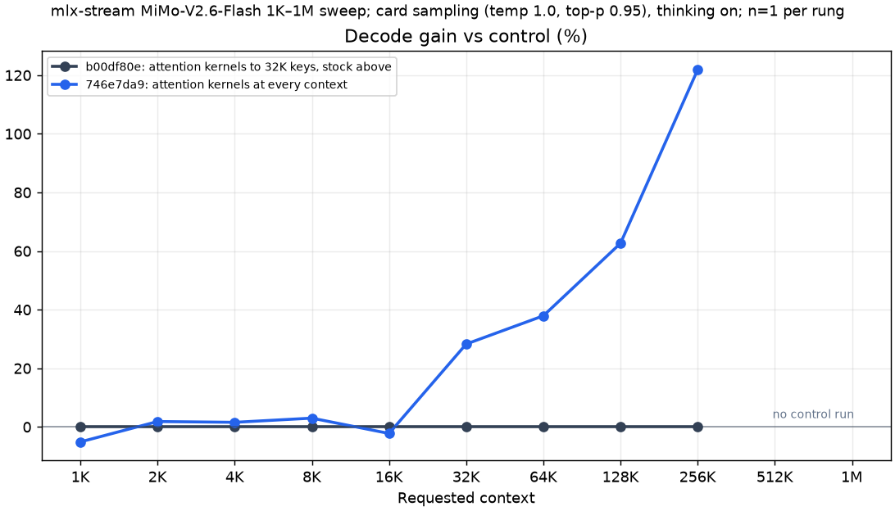
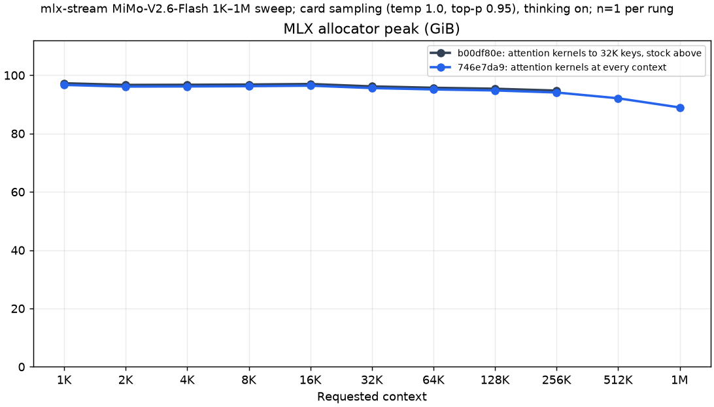
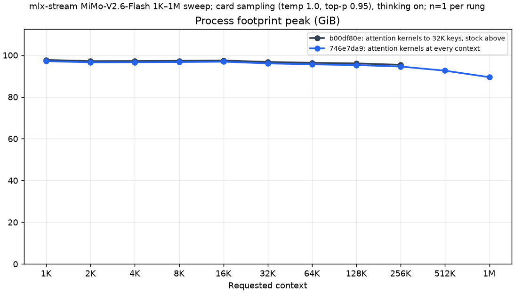

# MiMo-V2.6-Flash 1K–1M sweep: benchmark record

This directory records the long-context sweep behind the plugin's MiMo attention routes: one request per context rung,
from 1K to 1M prompt tokens, for MiMo-V2.6-Flash served by mlx-serve through mlx-stream. The two arms are server
builds one plugin commit apart on the same host (mlx-serve `pr/mimo-host` at `2c041af6`):

1. control `b00df80e` (plugin `d3a8555`): the arch's decode attention kernels (split-K full, windowed sliding) and NAX
   prompt attention up to a served context of 32,768 keys, MLX's stock attention above it;
2. candidate `746e7da9` (plugin `8e7d186`, "mimo: attention kernel routes at every served context"): the same kernels
   at every served context, up to the checkpoint's 1,048,576 keys. This is the configuration the PR ships.

Up to the 16K rung (served context 32,768) both builds install the same routes, so the differences there come from
expert rows and sampling, not from the change. From the 32K rung (served context 49,152) up, the control runs MLX's
stock attention.


## Matched serving configuration

Both arms used the same pack, server flags and request shape:

- Apple M5 Max with 128 GB of unified memory, fans at maximum, no other model server loaded, each server run
  serialized by the machine's exclusive GPU guard;
- pack `OpensourceWTF/MiMo-V2.6-Flash-MOPD-fp8res-mlx-stream`: the release's MXFP4 experts streamed from the internal
  SSD, FP8 residents;
- GPU memory ceiling 112 GiB (`MLX_SERVE_GPU_CEILING_MB=114688`, the wired limit raised to match) with
  `--wired-margin-gib 2`;
- 16-bit KV cache (BF16, `--kv-quant off`), prefix cache off;
- the MTP draft lane at its defaults (typical acceptance 0.5, three heads; `"enable_mtp": true`);
- card sampling: temperature 1.0, top-p 0.95, seed 1, no top-k; thinking on; `max_tokens` 16,384;
- a fresh server per rung, serving one request: `POST /v1/completions` with the prompt rendered by the pack's chat
  template.

```sh
MLX_SERVE_GPU_CEILING_MB=114688 nice -n 19 mlx-serve serve --model <pack> \
  --host 127.0.0.1 --port 8081 --ctx-size <served context> --timeout 0 \
  --no-vision --no-warmup-eager --prefix-cache-entries 0 --metrics \
  --log-file off --kv-quant off --wired-margin-gib 2
```

Each server's log names the routes it installed: the control's 32K–256K servers log `route decode_attention=stock
reason=ctx>32768 keys` and `route prefill_attention=stock`; the control's 1K–16K servers and every candidate server
log `decode_attention=kernels` and `prefill_attention=nax`.

Requested context is the prompt fixture's nominal length; the served context (`--ctx-size`) adds the 16,384-token cap.
The 1M fixture is 1,032,192 tokens, so that its served context is the checkpoint's 1,048,576-token limit. Actual input
is the server's prompt count: with thinking on the request drops the fixture's trailing `<think></think>`, two tokens.

Expert rows (slot rows per routed layer, prompt phase / decode phase) were pinned per rung in the pack's `config.json`
at the memory bill's fill, for a 12.0 GB box baseline on the control and 12.6 GB on the candidate. The candidate
therefore ran one row per layer fewer at every rung, and from 64K up one more prompt row fewer, because its bill also
charges the NAX prompt attention past 32,768 keys. Its gains do not come from rows.

| Requested context | Served context | Rows P/D, control | Rows P/D, candidate |
| ---: | ---: | ---: | ---: |
| 1K | 17,407 | 131/148 | 130/147 |
| 2K | 18,432 | 130/147 | 129/146 |
| 4K | 20,480 | 130/147 | 129/146 |
| 8K | 24,576 | 130/147 | 129/146 |
| 16K | 32,768 | 130/147 | 129/146 |
| 32K | 49,152 | 129/145 | 128/144 |
| 64K | 81,920 | 127/143 | 125/142 |
| 128K | 147,456 | 123/140 | 121/139 |
| 256K | 278,528 | 116/134 | 114/133 |
| 512K | 540,671 | — | 98/120 |
| 1M | 1,048,576 | — | 67/96 |

Every point is one request per arm and rung (n=1), with no uncertainty interval. `results.json` holds the 22 arm and
rung rows, 20 of them measured. The control has no 512K or 1M point: the pre-launch memory gate skipped its 256K–1M
rungs in the first pass (box baseline 12.6–12.7 GB against pins admitting up to 12.05–12.41 GB), and a relaunch after
the box settled ran 256K. That relaunch's 512K request was cancelled during its prompt pass to fix the attention
routes (the change measured here), which ended the chain before 1M; neither rung was rerun on the control.

## Decode

| Requested context | Actual input | Rows P/D, control | Rows P/D, candidate | Control | Candidate | Gain |
| ---: | ---: | ---: | ---: | ---: | ---: | ---: |
| 1K | 1,021 | 131/148 | 130/147 | 33.3 | 31.6 | -5.1% |
| 2K | 2,046 | 130/147 | 129/146 | 32.5 | 33.1 | +1.8% |
| 4K | 4,094 | 130/147 | 129/146 | 31.7 | 32.2 | +1.6% |
| 8K | 8,190 | 130/147 | 129/146 | 30.0 | 30.9 | +3.0% |
| 16K | 16,382 | 130/147 | 129/146 | 31.4 | 30.7 | -2.2% |
| 32K | 32,766 | 129/145 | 128/144 | 24.4 | 31.3 | +28.3% |
| 64K | 65,534 | 127/143 | 125/142 | 21.1 | 29.1 | +37.9% |
| 128K | 131,070 | 123/140 | 121/139 | 15.8 | 25.7 | +62.7% |
| 256K | 262,142 | 116/134 | 114/133 | 9.6 | 21.3 | +121.9% |
| 512K | 524,285 | — | 98/120 | — | 15.4 | — |
| 1M | 1,032,190 | — | 67/96 | — | 9.6 | — |




Below 32K the two builds run the same routes: the -5.1% to +3.0% there is the control's extra expert row and a
different sampled answer, at n=1. From 32K, where the control switches to MLX's stock attention, its decode falls much
faster with context: 24.4 against 31.3 tok/s at 32K (+28.3%), 15.8 against 25.7 at 128K (+62.7%) and 9.6 against 21.3
at 256K (+121.9%). The candidate holds 29.1–33.1 tok/s to 64K and reads 15.4 at 512K and 9.6 at 1M.

## Prefill

| Requested context | Actual input | Rows P/D, control | Rows P/D, candidate | Control | Candidate | Gain |
| ---: | ---: | ---: | ---: | ---: | ---: | ---: |
| 1K | 1,021 | 131/148 | 130/147 | 92.3 | 92.3 | 0.0% |
| 2K | 2,046 | 130/147 | 129/146 | 178.1 | 178.3 | +0.1% |
| 4K | 4,094 | 130/147 | 129/146 | 347.0 | 345.5 | -0.4% |
| 8K | 8,190 | 130/147 | 129/146 | 654.6 | 654.4 | 0.0% |
| 16K | 16,382 | 130/147 | 129/146 | 1,000.3 | 978.5 | -2.2% |
| 32K | 32,766 | 129/145 | 128/144 | 753.5 | 827.8 | +9.9% |
| 64K | 65,534 | 127/143 | 125/142 | 661.8 | 743.9 | +12.4% |
| 128K | 131,070 | 123/140 | 121/139 | 488.0 | 599.9 | +22.9% |
| 256K | 262,142 | 116/134 | 114/133 | 311.3 | 439.9 | +41.3% |
| 512K | 524,285 | — | 98/120 | — | 296.1 | — |
| 1M | 1,032,190 | — | 67/96 | — | 179.6 | — |


Prefill matches below 32K; the 16K rung's -2.2% is within one prompt row and the GPU clock's run-to-run swing (about
6%). From 32K the candidate's NAX prompt attention is 9.9% faster at 32K, 22.9% at 128K and 41.3% at 256K. Every rung
is a fresh server's first request, and a fixed cost of about 11 s dominates its TTFT at 1K–8K, so prefill rises to its
16K peak (978.5–1,000.3 tok/s) before attention's growth with the prompt brings it down.

## Time to first token

| Requested context | Actual input | Rows P/D, control | Rows P/D, candidate | Control | Candidate | Difference (s) |
| ---: | ---: | ---: | ---: | ---: | ---: | ---: |
| 1K | 1,021 | 131/148 | 130/147 | 11.06 | 11.06 | 0.00 |
| 2K | 2,046 | 130/147 | 129/146 | 11.49 | 11.48 | -0.01 |
| 4K | 4,094 | 130/147 | 129/146 | 11.80 | 11.85 | +0.05 |
| 8K | 8,190 | 130/147 | 129/146 | 12.51 | 12.52 | 0.00 |
| 16K | 16,382 | 130/147 | 129/146 | 16.38 | 16.74 | +0.36 |
| 32K | 32,766 | 129/145 | 128/144 | 43.49 | 39.58 | -3.90 |
| 64K | 65,534 | 127/143 | 125/142 | 99.02 | 88.10 | -10.93 |
| 128K | 131,070 | 123/140 | 121/139 | 268.59 | 218.49 | -50.10 |
| 256K | 262,142 | 116/134 | 114/133 | 842.09 | 595.91 | -246.18 |
| 512K | 524,285 | — | 98/120 | — | 1,770.63 | — |
| 1M | 1,032,190 | — | 67/96 | — | 5,747.16 | — |


TTFT is prompt tokens / the server's prefill rate, as the receipts derive it from the server's per-request line: the
prompt pass without the HTTP round trip, at the prefill rate's 0.1 tok/s rounding (so the 1K rung reads 11.06 s on
both builds). At 256K the candidate's first token comes 246 s sooner (595.91 against 842.09 s); at 1M it takes 5,747 s
(1.6 h) for 1,032,190 prompt tokens.

## MLX allocator peak

| Requested context | Actual input | Rows P/D, control | Rows P/D, candidate | Control | Candidate | Difference (GiB) |
| ---: | ---: | ---: | ---: | ---: | ---: | ---: |
| 1K | 1,021 | 131/148 | 130/147 | 97.26 | 96.67 | -0.59 |
| 2K | 2,046 | 130/147 | 129/146 | 96.69 | 96.11 | -0.58 |
| 4K | 4,094 | 130/147 | 129/146 | 96.74 | 96.15 | -0.59 |
| 8K | 8,190 | 130/147 | 129/146 | 96.83 | 96.24 | -0.59 |
| 16K | 16,382 | 130/147 | 129/146 | 97.00 | 96.42 | -0.59 |
| 32K | 32,766 | 129/145 | 128/144 | 96.18 | 95.60 | -0.59 |
| 64K | 65,534 | 127/143 | 125/142 | 95.72 | 95.13 | -0.59 |
| 128K | 131,070 | 123/140 | 121/139 | 95.38 | 94.78 | -0.60 |
| 256K | 262,142 | 116/134 | 114/133 | 94.75 | 94.08 | -0.66 |
| 512K | 524,285 | — | 98/120 | — | 92.10 | — |
| 1M | 1,032,190 | — | 67/96 | — | 88.95 | — |



`mlx_peak` from the plugin's `MiMo decode memory` line, logged once at the end of the request: MLX's peak since the
server started, one request per server. It falls from 96.67 GiB at 1K to 88.95 GiB at 1M on the candidate as the bill
gives expert rows to the KV. The candidate's is 0.6–0.7 GiB lower at every paired rung: one decode row per layer is 47
expert records of 13,369,344 bytes, 0.59 GiB.

## Process footprint peak

| Requested context | Actual input | Rows P/D, control | Rows P/D, candidate | Control | Candidate | Difference (GiB) |
| ---: | ---: | ---: | ---: | ---: | ---: | ---: |
| 1K | 1,021 | 131/148 | 130/147 | 97.74 | 97.15 | -0.59 |
| 2K | 2,046 | 130/147 | 129/146 | 97.17 | 96.59 | -0.59 |
| 4K | 4,094 | 130/147 | 129/146 | 97.22 | 96.63 | -0.59 |
| 8K | 8,190 | 130/147 | 129/146 | 97.31 | 96.72 | -0.59 |
| 16K | 16,382 | 130/147 | 129/146 | 97.48 | 96.89 | -0.58 |
| 32K | 32,766 | 129/145 | 128/144 | 96.78 | 96.07 | -0.70 |
| 64K | 65,534 | 127/143 | 125/142 | 96.36 | 95.61 | -0.75 |
| 128K | 131,070 | 123/140 | 121/139 | 96.08 | 95.26 | -0.81 |
| 256K | 262,142 | 116/134 | 114/133 | 95.39 | 94.57 | -0.83 |
| 512K | 524,285 | — | 98/120 | — | 92.60 | — |
| 1M | 1,032,190 | — | 67/96 | — | 89.48 | — |



The server process's lifetime peak physical footprint (`darwin_peak_footprint_bytes` in the receipt, sampled every
half second). It and the MLX peak have different scopes and must not be added. Every rung stayed under the bill's
process bound (97.9–99.2 GiB): by 1.4–3.8 GiB to 256K, 5.3 GiB at 512K and 8.7 GiB at 1M. The whole machine peaked at
103.1–108.8 GiB against the 112 GiB ceiling. The [README](../../../README.md)'s ladder table quotes the same
footprints in decimal GB (104.31 GB = 97.15 GiB at 1K).

## Completion tokens

| Requested context | Actual input | Rows P/D, control | Rows P/D, candidate | Control | Candidate | Finish |
| ---: | ---: | ---: | ---: | ---: | ---: | ---: |
| 1K | 1,021 | 131/148 | 130/147 | 695 | 659 | stop |
| 2K | 2,046 | 130/147 | 129/146 | 650 | 683 | stop |
| 4K | 4,094 | 130/147 | 129/146 | 605 | 655 | stop |
| 8K | 8,190 | 130/147 | 129/146 | 1,323 | 664 | stop |
| 16K | 16,382 | 130/147 | 129/146 | 688 | 683 | stop |
| 32K | 32,766 | 129/145 | 128/144 | 609 | 676 | stop |
| 64K | 65,534 | 127/143 | 125/142 | 645 | 624 | stop |
| 128K | 131,070 | 123/140 | 121/139 | 659 | 620 | stop |
| 256K | 262,142 | 116/134 | 114/133 | 641 | 651 | stop |
| 512K | 524,285 | — | 98/120 | — | 622 | stop |
| 1M | 1,032,190 | — | 67/96 | — | 639 | stop |


Every request stopped on EOS (`finish_reason: stop`), with 605–695 tokens except the control's 8K answer (1,323). The
two builds' answers differ at every rung: a sampled request's tokens reproduce only at equal rows and, from 32K, equal
attention routes.

## Provenance and receipts

- Cells: the lab's `reports/dsv41-f39-tcq3-runtime/mimo/cells/ladder2-20261011` (control) and `ladder3-20261011`
  (candidate), outside this repository. Each rung's `<rung>/cell/` holds `receipt.json` (the server command and
  environment, the request body, the numbers), `request.json`, `response.json`, `server.log` and `output.txt`.
  `results.json` names each row's cell and the SHA-256 of its receipt, prompt and output.
- Binaries (server SHA-256 prefix): candidate `746e7da9` = host `2c041af6` + plugin `8e7d186`; control `b00df80e` =
  host `2c041af6` + plugin `d3a8555`, the parent of `8e7d186`. The binary of record, `4b018c54` (host `2c041af6` +
  plugin `05fc760`: `8e7d186` plus the hot-path audit and the dead-code sweep), reproduces `746e7da9`'s 16K cell token
  for token (cell stamp16k-g15-20261011).
- Runs, 2026-10-11: control 1K–128K 15:35–15:50Z, 256K 15:57–16:12Z, 512K cancelled at 16:14Z; candidate 1K–512K
  17:13–18:06Z, 1M 18:08–19:46Z.
- Prefill and decode are the server's own per-request line, e.g. `<- 16382+683 tokens (39186ms) [prefill: 978.5 tok/s,
  decode: 30.7 tok/s] [stop]`. `python3 scripts/mimo_sweep_charts.py --cells-root <cells>` rebuilds `results.json`,
  checking each receipt against that line, the rung's `DONE` line and the chain's `LADDER_ROW` line; without
  `--cells-root` it redraws the PNGs from `results.json`, and `--tables` prints this README's tables.
