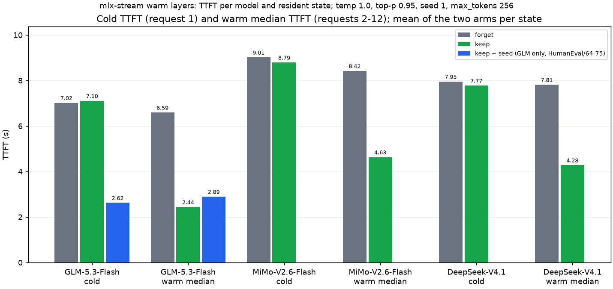
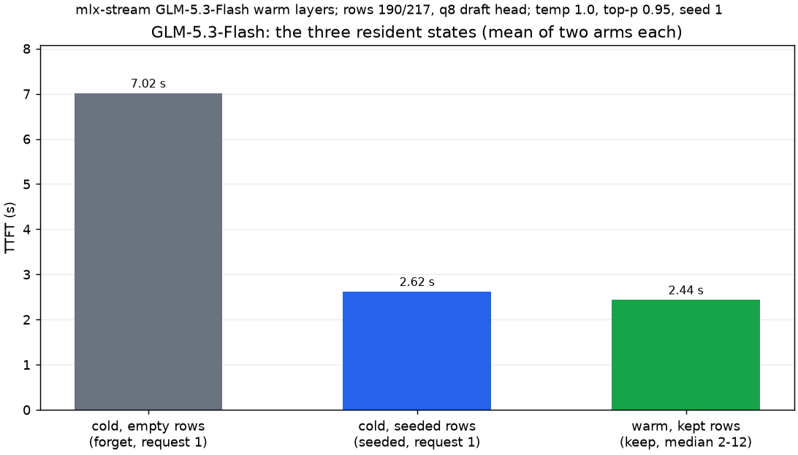
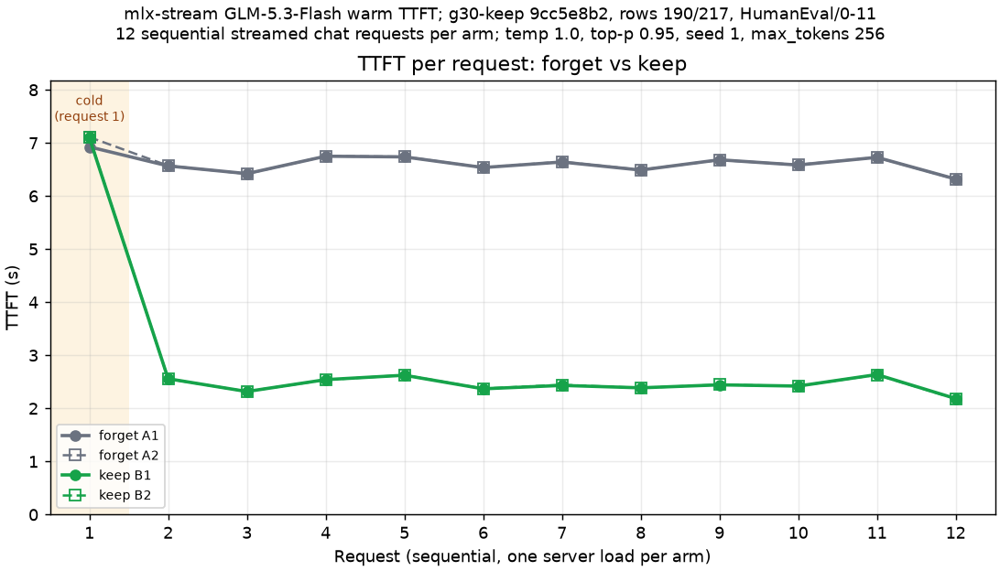
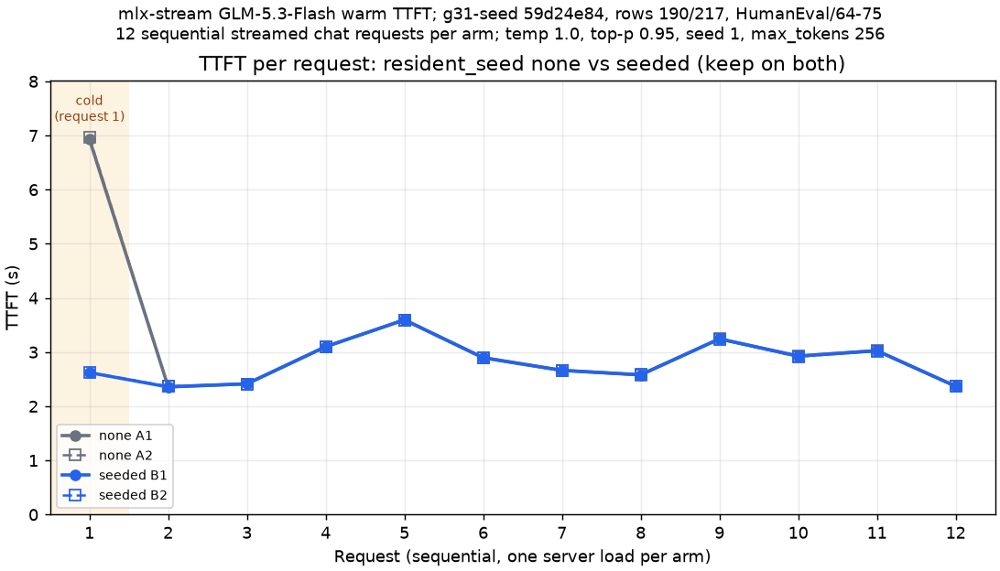
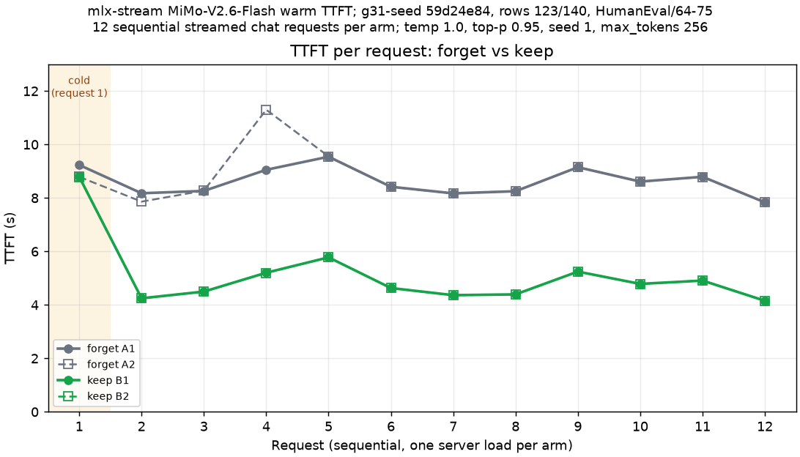
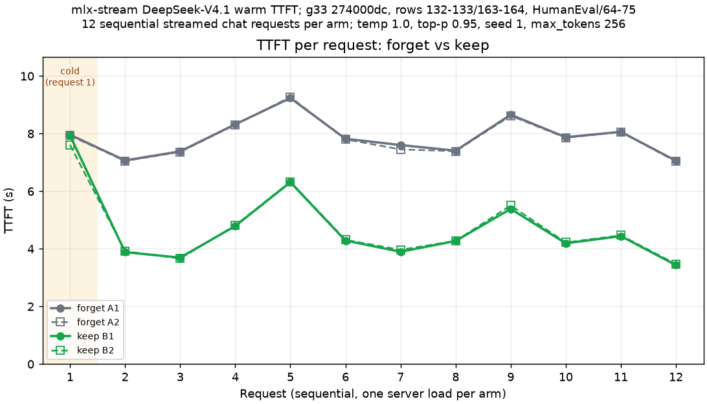

# Warm-layer TTFT: benchmark record (2026-10-15)

This directory records the time to first token (TTFT) of short chat requests on the three streamed models of mlx-stream
(GLM-5.3-Flash, MiMo-V2.6-Flash and DeepSeek-V4.1) in three expert-resident states. The prompt phase of a short request
is expert reads, not compute. The state of the expert rows at the start of the prompt sets the TTFT.

## The three states

- **Cold, empty rows.** The first request after the server loads. The prompt rows hold no experts, so the prompt phase
  reads every expert that it routes to from the SSD.
- **Cold, seeded rows.** The first request after a load with `resident_seed` at its default (`usage`). At load, the
  server fills the prompt rows from the pack's `expert-usage-v1.json` profile before it accepts a request.
- **Warm, kept rows.** A later request with `prompt_residents: keep` (the default). The residents that decode left in the
  prompt rows stay for the next prompt. With `prompt_residents: forget` (the old route), each prompt phase reads its
  experts again.

A kept or seeded slot holds the bytes of its own expert record. The state changes which experts the stream must read,
not the arithmetic.

On GLM-5.3-Flash a seeded cold request (2.62 s) is near a warm request with kept rows (2.44 s). An empty cold request
takes 7.02 s. The forget and keep bars use HumanEval problems 0-11; the seeded bar uses problems 64-75.

## Method

- Apple M5 Max with 128 GB of unified memory, the real mlx-serve server binary, each server run serialized by the
  exclusive GPU guard of the machine.
- One server load per arm, arms in the order A B B A (two arms per state).
- 12 sequential `/v1/chat/completions` requests per arm, HumanEval problems as the user message, thinking off.
- Sampling: temperature 1.0, top-p 0.95, seed 1, `max_tokens` 256, streamed.
- TTFT is the client time from the request to the first streamed token. Request 1 is the cold request. "Warm" is
  requests 2-12.
- Decode is the median over requests 2-12 of the server's streamed `decode: Y tok/s` line. The GLM keep pair has no
  server line in its records; its decode is the client value (completion tokens minus one, over wall time minus TTFT).
- "Outputs identical" compares the completion token count and the character count of each request across the four
  arms.

`results.json` holds every per-request TTFT, wall time, token count and character count, and the per-arm summaries.

## GLM-5.3-Flash

Build g30-keep (server SHA-256 `9cc5e8b2`), rows 190/217, q8 draft head, HumanEval problems 0-11. A = `forget`,
B = `keep`.

| Arm | Cold TTFT (ms) | Warm median (ms) | Warm mean (ms) | Decode median (tok/s, client) |
| :--- | ---: | ---: | ---: | ---: |
| A1 forget | 6,925.6 | 6,583.5 | 6,586.9 | 37.9 |
| B1 keep | 7,098.9 | 2,432.8 | 2,446.9 | 37.7 |
| B2 keep | 7,108.4 | 2,444.2 | 2,447.3 | 37.7 |
| A2 forget | 7,109.2 | 6,589.1 | 6,588.1 | 36.7 |

Keep cuts the warm median by 63.0 % (6.59 s to 2.44 s). The cold request does not change. All 12 outputs are identical
in the four arms.

### Resident seed

Build g31-seed (server SHA-256 `59d24e84`), rows 190/217, q8 draft head, HumanEval problems 64-75, `keep` on both arms.
A = `resident_seed: none`, B = seeded (the default).

| Arm | Load (s) | Cold TTFT (ms) | Warm median (ms) | Warm mean (ms) | Decode median (tok/s) |
| :--- | ---: | ---: | ---: | ---: | ---: |
| A1 none | 10 | 6,933.7 | 2,898.9 | 2,834.8 | 41.0 |
| B1 seeded | 16 | 2,621.7 | 2,893.9 | 2,833.4 | 41.4 |
| B2 seeded | 15 | 2,625.4 | 2,894.4 | 2,831.8 | 41.5 |
| A2 none | 9 | 6,969.5 | 2,899.1 | 2,832.7 | 41.6 |

The seed cuts the cold TTFT by 62.3 % (6.95 s to 2.62 s). It does not change the warm requests. All 12 outputs are
identical in the four arms.

Seed facts, from the install line of the seeded arms:

- The seed fills 190 of 190 prompt rows per layer: 7,980 records, 75.6 GB, read in 5.6 s at load. The load takes about
  6 s longer.
- The profile comes from 65 requests (HumanEval problems 0-63 and one standard 16K prompt; 27,266 prompt and 9,887
  decode tokens). The top 190 experts of each layer carry 79-90 % of the routed mass.
- The seed requests (64-75) are not in the profile requests (0-63).

## MiMo-V2.6-Flash

Build g31-seed (server SHA-256 `59d24e84`), BF16 residents, rows 123/140, HumanEval problems 64-75. A = `forget`,
B = `keep`.

| Arm | Cold TTFT (ms) | Warm median (ms) | Warm mean (ms) | Decode median (tok/s) |
| :--- | ---: | ---: | ---: | ---: |
| A1 forget | 9,234.7 | 8,418.5 | 8,569.6 | 30.2 |
| B1 keep | 8,789.1 | 4,631.0 | 4,746.3 | 30.3 |
| B2 keep | 8,786.7 | 4,627.3 | 4,744.7 | 29.7 |
| A2 forget | 8,789.4 | 8,416.9 | 8,747.5 | 30.2 |

Keep cuts the warm median by 45.0 % (8.42 s to 4.63 s). The outputs are not identical between the states. Requests 4,
7 and 8 have different token counts; request 11 has the same token count and one more character. The two arms of each
state are identical to each other. The difference is rounding-class, from the per-tile kernel choice: a different
resident state can give a different kernel for a tile, and so a different rounding.

## DeepSeek-V4.1

Build g33 (server SHA-256 `274000dc`), rows at the bill's fill (132-133 prompt / 163-164 decode), HumanEval problems
64-75. A = `forget`, B = `keep`.

| Arm | Cold TTFT (ms) | Warm median (ms) | Warm mean (ms) | Decode median (tok/s) |
| :--- | ---: | ---: | ---: | ---: |
| A1 forget | 7,962.0 | 7,822.9 | 7,864.6 | 25.5 |
| B1 keep | 7,937.3 | 4,274.6 | 4,419.4 | 24.8 |
| B2 keep | 7,610.2 | 4,279.2 | 4,451.1 | 24.6 |
| A2 forget | 7,932.1 | 7,803.8 | 7,837.3 | 25.5 |

Keep cuts the warm median by 45.3 % (7.81 s to 4.28 s). All 12 outputs are identical in the four arms. The rows came
from the memory bill's fill at each load and are not the same in all arms (133/164, 133/163, 132/163, 132/163).

## Summary

Means of the two arms per state, in seconds:

| Model | Prompts | Cold, forget | Cold, keep | Cold, seeded | Warm median, forget | Warm median, keep | Warm median, seeded |
| :--- | :--- | ---: | ---: | ---: | ---: | ---: | ---: |
| GLM-5.3-Flash | 0-11 (seeded: 64-75) | 7.02 | 7.10 | 2.62 | 6.59 | 2.44 | 2.89 |
| MiMo-V2.6-Flash | 64-75 | 9.01 | 8.79 | | 8.42 | 4.63 | |
| DeepSeek-V4.1 | 64-75 | 7.95 | 7.77 | | 7.81 | 4.28 | |

The GLM seeded values use other prompts than the GLM forget and keep values. Compare them with the not-seeded arms of
the seed pair (cold 6.95 s, warm median 2.90 s).

## Provenance

The measurements are the cells of 2026-10-15 in the lab's reports tree, outside this repository:
`glm5next-warmttft-20261015` (batch 69), `glm5next-seedpair-20261015` (batch 72), `mimo-warmttft-g31-20261015`
(batch 73) and `dsv41-warmttft-g33b-20261015` (batch 74b), one `warm.jsonl` per arm. The charts and `results.json` were
made from these files by `warm-layer-charts-20261015/warm_charts.py` in the same tree.
