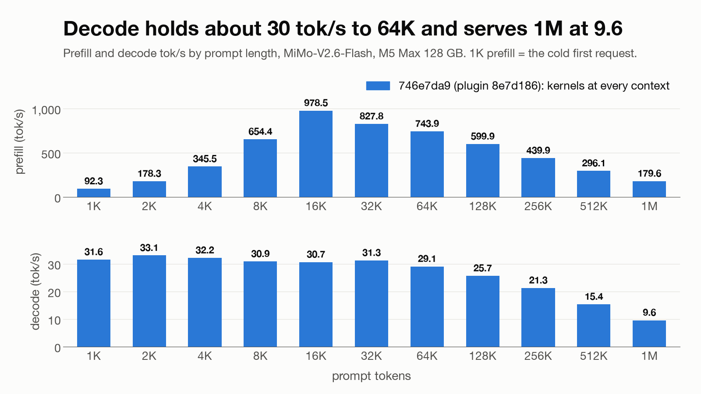
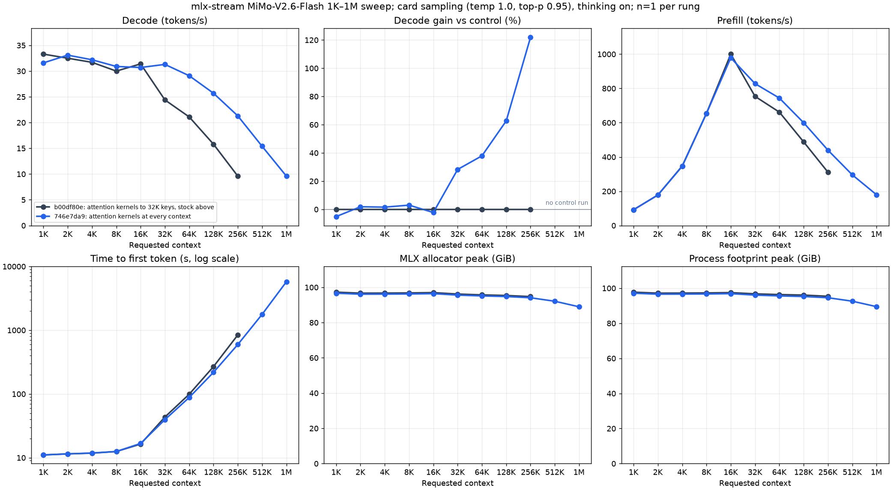
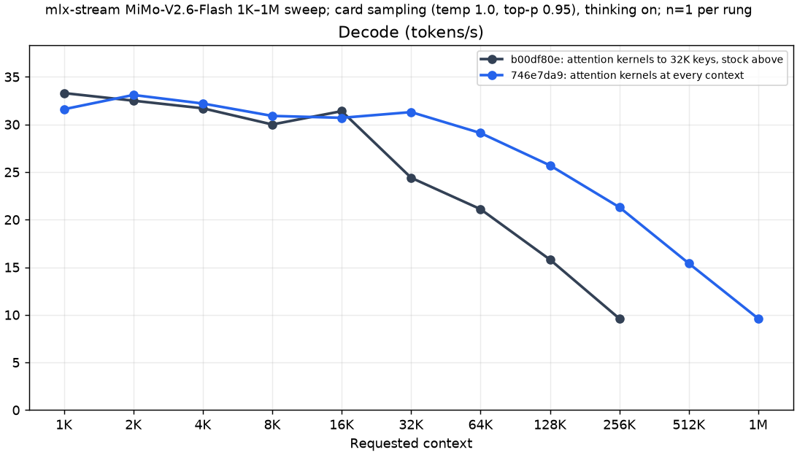
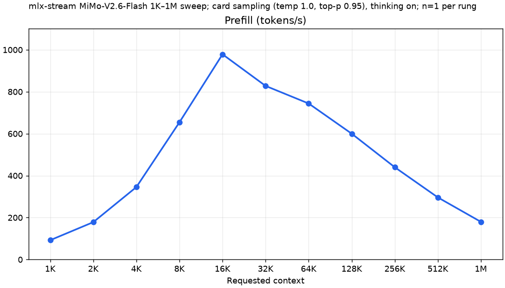
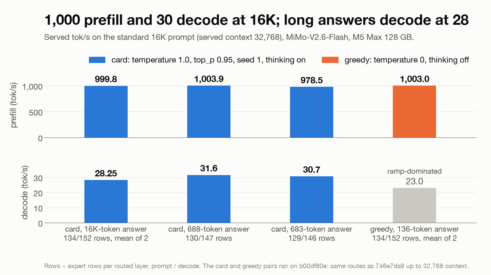
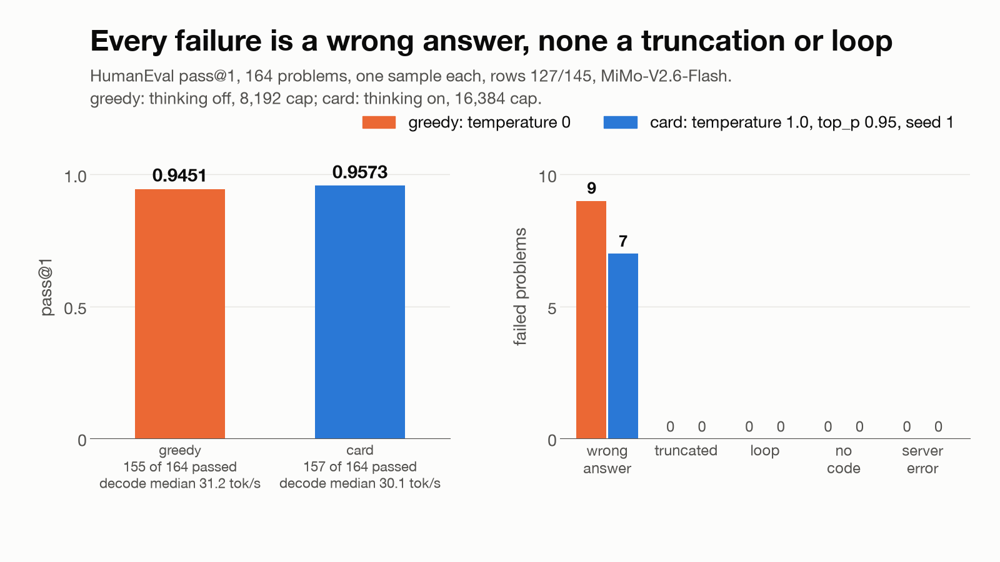
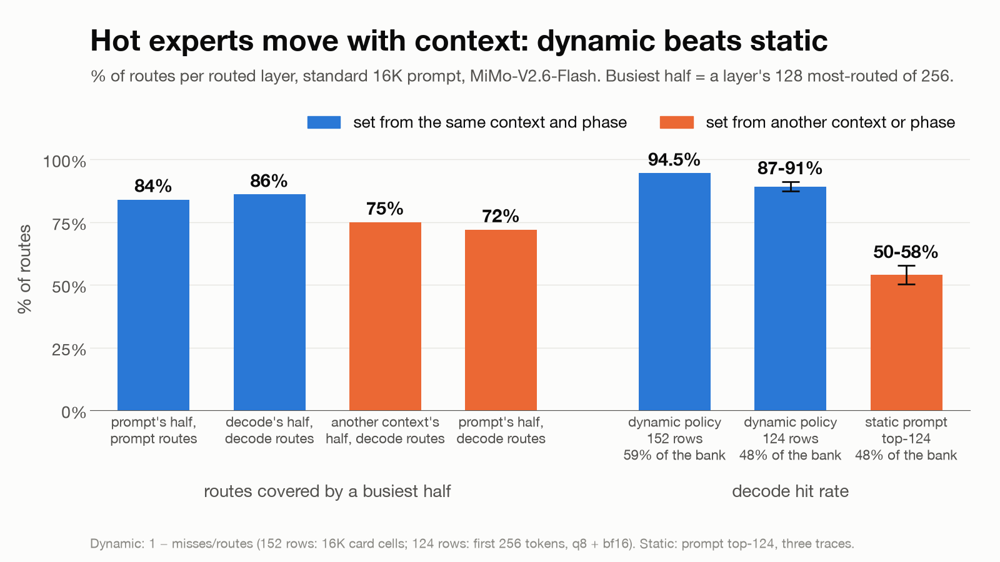

# MiMo-V2.6-Flash (`mimo_v2_flash`)

mlx-stream's second arch serves Xiaomi's MiMo-V2.6-Flash with its 12,032 routed experts (47 routed layers x 256)
streamed from the SSD as an MXFP4 expert bank, through the same expert reader DeepSeek-V4.1 uses. The trunk is
resident in the release's FP8 or in BF16. The pack's three trained MTP heads drive the draft lane. A 16K-token prompt
runs on a 128 GB Mac at about 107 GB peak.

This page covers what the arch claims, its memory bill, the decode path, the draft lane, the prompt pass, its
settings and its limits. Preparing a pack is in [mimo-pack.md](mimo-pack.md). Measured lines are in the README
(MiMo-V2.6-Flash).

Terms used throughout: **pack** = the prepared model directory; **residents** = the non-expert weights, loaded once;
**rows** (prompt rows, decode rows) = expert slot rows per routed layer, the experts held resident at once; **bill** =
the itemized memory bound per phase; **fill** = the row count the bill admits under the ceiling; **prompt pass** = the
forward over the prompt ("prefill" only in tok/s metrics and setting keys); **route** = a choice made once at
construction; **control** = the unchanged route a default was measured against.

Code: `src/arch/mimo_v2/` (`root.zig` the arch contract, `settings.zig` the settings, `bill.zig` the bill, `module.zig` the
forward, `source.zig` / `stream.zig` the expert source, `draft.zig` / `mtp.zig` the draft lane), Metal texts in
`src/arch/mimo_v2/kernels/`.

## The model

48 layers, hidden 4,096, vocabulary 152,576, up to 1,048,576 positions. Layer 0 has a dense SwiGLU MLP (width 16,384);
layers 1-47 route each token to 8 of 256 experts (sigmoid scores, `noaux_tc`, MoE width 2,048, no shared experts).
Nine layers (0, 5, 11, 17, 23, 29, 35, 41, 47) use full attention with 4 KV heads; the other 39 use sliding-window
attention (window 128, 8 KV heads, attention sinks). 64 query heads, key head width 192, value head width 128, partial
rotary over 64 dimensions.

## Claim and load

- **Claim.** The arch claims a `config.json` with `"model_type": "mimo_v2_flash"` and the `expert_streaming` block
  (`family: mlx-stream`, `format: mlx-stream-mxfp4-expert-bank-v1`, `manifest: expert-manifest.json`) at `native`. It
  declines DeepSeek-V4.1's packs and upstream MiMo checkpoints (no block; mlx-serve's resident `mimo_v2` arch serves
  those). A `mimo_v2_flash` config without the block is refused with `MimoRepackRequired`.
- **Parse.** Every geometry key is checked against the supported model and refused by name when it differs (a wrong
  layer pattern, shared experts, rope scaling, mixed storage within a projection role, an FP8 entry without
  `residents_format`, ...). The `expert_streaming.settings` object is read here ([Settings](#settings)).
- **Caps.** `owns_decode_state` (the module keeps its own KV and draft state: one request at a time, no prefix cache,
  every request runs its whole prompt), `prefill_whole_prompt`, `prefill_yields_last_logits`,
  `residents_past_page_cache`.
- **Reader.** The arch claims the process's one expert reader at its load (`claimProcess`). A second arch in the same
  process that needs it (DeepSeek-V4.1 or another MiMo) fails at its claim with `ExpertReaderInUse`.
- **Construction checks.** The residents' safetensors headers are bounded and checked before the host loads them; the
  expert manifest is validated in full (geometry, segments, every record's offset, source revision, the file's size);
  `experts.bin` is opened `F_NOCACHE`, never through a symlink, and its size must match; every MTP head tensor is
  hashed against its manifest before it becomes an array. The Metal kernel texts are pinned by sha256 in six manifests
  (`src/arch/mimo_v2/kernels/manifest-*.json`). Nothing re-hashes the 161 GB bank at load: that is the pack build's parity
  step.

## Residents tiers

| tier | resident projections | route |
|---|---|---|
| fp8res (pack of record) | q/k/v and layer 0's dense MLP in the release's FP8 e4m3 codes, one f32 scale per 64 x 128 tile; embeddings, head and o_proj BF16 | decode: FP8 GEMV kernels on the codes; prompt pass: each FP8 projection dequantized once per layer and chunk into a BF16 cache (`fp8_prompt_slots`), then a GEMM |
| bf16res | BF16 | MLX's GEMM and GEMV |

fp8res's weights are the release's bit for bit; its decode GEMV is rounding-class against bf16res, so the two tiers'
greedy ids diverge within the first few dozen tokens. The parser also accepts affine 4- and 8-bit residents
(group 32 or 64); no pack of record uses them.

## Memory: the bill

The arch bills its memory before it allocates anything, as DeepSeek-V4.1 does (`sdk.MemoryBill`): every term is an
upper bound, by geometry or by a measured reading, and the host admits a load and a request against it.

**Target.** The host's GPU ceiling less its wired margin, over the box's baseline: physical memory in use less the
pack's own page cache, floored at the host's non-file baseline. The context billed is the host's `ctx_size` for the
model (`LoadFacts.effective_context`), else 17,408 tokens (16,384 prompt + 1,024 generated).

**Phase rows** (`phase_rows`, default on). The prompt pass and decode are billed apart. The prompt-only terms (the
token and layer workspaces, the routed join, the transient rows, the prompt attention's span state, the MLX cache
pool) are billed in the prompt phase only, so decode admits more rows than the prompt pass: about 135 prompt and 152
decode rows at 16K on the fp8res pack. At the phase change the module frees the prompt scratch and grows every slot
bank by the difference. With the draft lane on, the growth waits for the lane's first draft (`decode_grow:
after_draft`): the heads' catch-up over the prompt's last rows runs at the prompt rows, inside the prompt phase's
bill, and the FP8 prompt cache is released before the growth.

**Terms.** Each term has a prompt-phase and a decode-phase bound:

- weights: `residents` (the file's resident bytes), `mtp_heads` (0 without the lane), `router_f32` (the transposed F32
  router copy the prompt router reads), `fp8_prompt_weights` (fp8res only; none in decode);
- the request: `request` (layer and token workspaces, masks, the prompt attention's arrays), the KV lanes (`kv_dense`,
  `kv_sliding_ring`, and under Q8 `kv_packed`, `kv_scales`, `kv_biases`, `kv_dequant`, `kv_update`, `kv_incoming`),
  `mtp_workspace` (the lane's verify graph, catch-up, row caches and rollback rows);
- MLX: `mlx_cache` (the cache limit: 2 GiB through the pooled prompt pass, 256 MiB in decode), `mlx_cache_overshoot`
  (one freed buffer over the limit: the phase's largest buffer);
- the host side: `host_runtime` and `compiler_runtime` (below);
- the expert source: `slot_transient` (the transient rows: 96 in the prompt pass, 32 in decode), `reader_staging`,
  `source_metadata`, `expert_workspace`, `predictor_workspace`, `predictor_runtime`, `predictor_metadata`,
  `event_runtime`, `event_graph`, `spec_staging`, `spec_runtime`, and per row 47 x 13,369,344 B = 628,359,168 B;
- wiring: `resident_wiring`, `request_wiring` and `slot_wiring` (the page tables over the wired bytes, at the 16 KiB
  geometry; `slot_wiring` follows the rows), `buffer_allowance` (DeepSeek-V4.1's measured wiring cost per live buffer
  times MiMo's own buffer census);
- `gpu_warm` (the keep-warm engine, 0 when off).

**The host side, measured.** The terms flagged `at_construction` are compared once with the footprint after
construction. The host side (footprint less MLX active and cache) is billed at measured readings, by DeepSeek-V4.1's
rule (the max-shape reading plus 0.02 GB for a long decode, rounded up to the next 50 MB):

- at construction: 400 MB (readings 320.56-326.28 MB over 74 served cells, both tiers, serial and draft lane);
- in decode: 550 MB for `host_runtime` and `compiler_runtime` together (34 readings, 304.0-495.0 MB; the largest
  494,965,441 B; no growth with context up to the 32K fixture), for constructions billed up to 33,792 tokens. Above
  that, and with `phase_rows: false`, decode bills the declared pair (1.0 GB host, 512 MiB compiler);
- in the prompt phase: the declared pair.

The bill is a report, not a gate. After construction the footprint and the host side are compared with the bill's
construction terms; an overage logs a `construction check: ... (an under-bill: proceeding)` warning and the load
continues. The box's live guard is the safety net. The load preflight (`loadBytes`) bills the fill's floor rows, as
DeepSeek-V4.1 does.

`MIMO_BANK=<pack> zig build test -Dmlx-serve=../mlx-serve -Dtest-filter="the bill tool prints every term"` prints
every term and the rows per context for a pack, from its headers.

## Expert rows

- **AUTO** (the default): the fill admits the most prompt rows and decode rows whose bill fits the target.
- **Forced:** `expert_rows` (decode rows) and `expert_prefill_rows` (prompt rows); either alone forces both. Forced
  rows are an operator contract and always load as named, as DeepSeek-V4.1's do. Over the fill, construction logs
  `forced rows <prompt>/<decode> exceed the fill by <N> bytes at baseline <B>; proceeding (operator pin)`. Only
  impossible counts refuse: zero rows or more decode rows than the 256 experts (`MimoExpertRows`), and prompt rows
  above decode rows (`MimoPhaseRows`).
- **Per-layer split** (`expert_rows_by_layer`). The default `derived` adds a fixed offset per routed layer to the
  admitted rows (from +82 to -44, summing to 0, so every bill term is the uniform split's). The offsets were derived
  from six route traces of non-benchmark prompts and held out on the benchmark prompts. Measured on the bf16res pack
  at 128 / 140 rows: misses per round 118.8 -> 101.2, decode +1.4 tok/s, ids identical within each arm. Where the
  offsets do not fit the admitted rows (a layer under one prompt row or over 256 decode rows), the default installs
  the uniform split at construction with one log line naming the admitted rows; a named `derived` is refused there.
  `uniform` is the control; an explicit array of 47 integers summing to 0 is accepted, and refused by name when it
  does not fit.

Rows change which experts are resident, not the arithmetic of a forward. They still change greedy ids: the prompt
pass groups its tiles by slot bank, so its outputs are rounding-class across row counts.

## Decode

Each decode forward (one row serially, up to four under the draft lane):

- **Attention.** At M <= 8, kernels over the BF16 KV views (`decode_attention: kernels`) at every served context, to
  the checkpoint's 1,048,576 keys; `decode_attention: stock` installs MLX's SDPA (the control).
  The KV is BF16 by default; `kv_quant: 8` stores it as affine Q8 group 64.
- **Glue.** Norms, residual adds, the router and the top-8 selection in fused kernels (`decode_glue: fused`), the
  stock ops' arithmetic.
- **Routed experts.** The routing barrier hands the host the ids. Experts already in the slot rows (hits) run from
  them; misses are read from `experts.bin` into the transient rows, each gated by an MLX event on its read. The MoE
  runs as fused MXFP4 kernels (`decode_moe: fused`, the `k1` kernel family) with a device pass over the hit experts
  (`decode_moe: hitpass`, the default). `stock` is MLX's grouped `gather_qmm`.
- **Lookahead.** A predictor scores the next layer's experts from the BF16 router weight (`predict_router: bf16`) and
  pre-reads the likely misses. The scores choose only pre-reads, so the route is token-exact.
- **Keep-warm.** While event-gated parts wait for their expert bytes, a trivial kernel on its own Metal queue keeps
  the GPU busy, so the parts after each wait do not start from an idle clock (`gpu_keep_warm: waits`). It touches only
  its own buffer. On a CPU stream the default installs nothing, with one log line.
- **Window 0.** Decode's transient rows are sized to the draft lane's widest route, 4 rows x top-8 = 32
  (`decode_window: verify`), not the SDK's 48.

## The draft lane

- **Heads.** The pack's three MTP heads (`model.mtp.layers.0-2`), each one sliding-window attention layer with sinks
  and a dense SwiGLU, feeding the trunk's head. Every head reads the trunk's final-normed hidden state; only the token
  shifts. A round drafts `draft_depth` tokens (1-3, default 3) and verifies 1 + depth rows in one trunk forward. The
  heads past the depth are still loaded and billed.
- **Acceptance** comes from `sdk_ext.acceptance`, the module every draft lane in this repo shares (DeepSeek-V4.1's
  DSpark lane uses it too). MiMo's lane applies its rule to every request (`acceptGeneral`):
  - `draft_tier: typical` (default) is Medusa's typical acceptance: a draft x at row r is kept iff
    p_r(x) > min(1, delta x exp(-H(p_r))), with `draft_delta` = 0.5 by default. On a greedy request p is the
    untempered target; the correction at the first rejected row and the bonus after an accepted run are the argmax, but
    a kept draft can be a token the target ranks below its argmax. On a sampled request p is the request's tempered,
    filtered target and every emitted token is a plain draw from it, so the output is not distributed as p. Lossy on
    both, by design.
  - `draft_tier: exact`: on a greedy request a draft is kept iff it equals the argmax; on a sampled request the lane
    runs exact speculative sampling, so every emitted token is distributed as p. Draws are keyed by (seed, absolute
    position), so a seeded request is reproducible however its rounds fall.
- **Which requests.** The host arms the lane per request: on for clean requests (no logprobs, grammar or penalties)
  unless the request sets `enable_mtp: false`; anything else runs serially. `mtp_lane: false` builds the serial
  control: no heads loaded, none billed.
- **State.** The sliding layers keep rollback rows for rejected drafts. Each round's draft statistics go to the host's
  draft receipt.

## The prompt pass

The prompt runs whole, in calls of up to 16,384 rows. Per routed layer:

- **Read-ahead** (`prefill_read_ahead`). A predictor on the layer's input ranks its experts, and the predicted records
  are read into the persistent rows while the layer's attention runs. The predictor's router tiles are evaluated in
  one eval per call (`prefill_predict_evals: one`).
- **Attention.** On a device with NAX, a NAX kernel for the 192 / 128 head widths with sinks at every served context
  (`prefill_attention`, unset = NAX). On a device without NAX the default installs MLX's attention at construction with
  one log line; a named `nax` is refused there. `prefill_attention: stock` installs MLX's attention (the control).
- **Expert tiles.** The experts run as sorted GEMM tiles grouped by slot bank. Each tile is handed only the slice of
  its bank its slots span (`prefill_bank_view: window`). Tiles drain pipelined: each projection and reduction tile is
  committed while the one before it finishes (`prefill_drain: pipelined`; the bill charges the second tile in flight).
- **Combine.** One kernel per routed layer combines the experts' outputs, reading every source in place through its
  GPU address (`prefill_combine: inplace`). In-place reads need the host's wired policy `max` (mlx-serve's default);
  under another policy the default installs `fused` (the same kernel over a merged copy) with one log line, and a
  named `inplace` is refused.
- **Scratch.** MLX's cache limit is raised to 2 GiB for the prompt pass and purged at a layer's end once half full,
  so a tile's freed temporaries serve the next tiles of the same shapes (`prefill_scratch: pooled`). Allocation only:
  every op writes its whole output.
- **Read schedule** (`prefill_read_schedule`), when the pass posts its reads:
  - `current`: the stream's stock schedule (DeepSeek-V4.1's route);
  - `early`: every group of a call is planned at its first route, as the stock schedule plans it, and each read is
    posted as soon as its row is free; the read-ahead's head is posted in rank order and its tail is resolved by the
    plans (read once if a group hits it first, never read if a plan evicts it first);
  - `early_whole`: `early`, with the whole read-ahead posted beside the attention, so it is read during the attention
    (at the cost of the stock schedule's reads of records a plan evicts before any hit);
  - `early_whole_trim` (default): `early_whole`, except that read-ahead jobs the reader has not started when the plans
    arrive are withdrawn (`q3ld_withdraw`: the job leaves the queue unread and writes no row) and resolved by the
    plans, as in `early`. Where the plans arrive before the read-ahead runs (short prompts) it reads what `early`
    reads; where every job has started it is `early_whole`. One schedule serves both lengths;
  - `auto`: `early` below `prefill_read_schedule_threshold` prompt tokens (default 8,192), `early_whole` at or above
    it, chosen once per request.

  Every schedule reads the same records into the same rows before any kernel reads them: exact.

## Measurements in charts

`python3 scripts/mimo_charts.py` draws these from the cells behind the README's measured lines (MiMo-V2.6-Flash).



The card ladder on `746e7da9` (this tree at `8e7d186`). The binary of record, `4b018c54` (this tree at `05fc760`),
differs from `746e7da9` only by the hot-path audit and the dead code sweep and reproduces its 16K cell token for token
(stamp16k-g15-20261011: 998.8 / 32.30 tok/s, 688 tokens).

**Full 1K–1M sweep.** The card ladder on `746e7da9` in mlx-serve's benchmark format: one line chart per metric
against requested context, with TTFT, both memory peaks and the answer lengths.
[benchmarks/mimo-v26-flash](benchmarks/mimo-v26-flash/README.md) has the tables, the matched configuration and the
receipts; `python3 scripts/mimo_sweep_charts.py` redraws it from its `results.json`.









The served 16K cells by answer length and rows; the greedy pair's 136-token answer makes its decode figure ramp-dominated.



HumanEval on `746e7da9`, greedy and card: every failed problem is a wrong answer.



Expert routing on the standard 16K prompt: the busiest half moves with the context, so a dynamic cache beats a static hot set.

## Reproducing the measurements

Every measured line (the README's MiMo-V2.6-Flash measurements and the charts above) came from one served cell: a fresh
server, one request and the cell's receipt. This is how those cells ran, from their receipts.

**The box.** One M5 Max with 128 GB. The wired limit was raised to the server's GPU ceiling,
`sudo sysctl iogpu.wired_limit_mb=114688` (the server logs `[wired] mode=max limit=114688 MB`);
`MLX_SERVE_GPU_CEILING_MB` must not exceed it. No other model server was loaded (the ladder also ran with Spotlight
off). `experts.bin` was a real file or a hard link, never a symlink. Prefill follows the GPU clock
([Limitations](#limitations)): compare cells at matched clocks, with the fans at maximum.

**The pack.** The fp8res pack of record ([mimo-pack.md](mimo-pack.md)), whose `config.json` carries the
`expert_streaming` block shown there.

**The server.** The 16K cells ran this command; each ladder rung ran the same with `--ctx-size` = its prompt + 16,384:

```sh
MLX_SERVE_GPU_CEILING_MB=114688 nice -n 19 mlx-serve serve --model /abs/path/to/pack --host 127.0.0.1 --port 8081 \
  --ctx-size 32768 --timeout 0 --no-vision --no-warmup-eager --prefix-cache-entries 0 --metrics --log-file off \
  --kv-quant off --wired-margin-gib 2
```

- `nice -n 19`, `--host` / `--port` and `--timeout 0` are the harness's.
- `--ctx-size` is the context the bill covers: the prompt plus the 16,384-token cap (32,768 for a 16K prompt).
- `--kv-quant off` keeps the BF16 KV; `--prefix-cache-entries 0` matches the arch, which has no prefix cache;
  `--no-vision` and `--no-warmup-eager` as passed.
- `--wired-margin-gib 2` under the 112 GiB ceiling sets the bill's target to 110 GiB (118,111,600,640 B).
- `--metrics` serves Prometheus metrics at `/metrics`; with `--log-file off` the harness captured stdout and stderr as
  the cell's `server.log`.
- Environment: `MLX_SERVE_GPU_CEILING_MB=114688` (the server logs `[diag] GPU ceiling forced to 114688 MB`). The harness
  removed every other `MLX_SERVE_*` variable, so the host's wired policy was its default, `max`. Nothing else is read
  from the environment: the shipping host ignores `MLX_STREAM_SETTINGS`, and a served build reads no `MIMO_*` variable.

**Pinned rows.** The cells pinned the rows in the pack's `config.json`, in a per-cell copy of the pack (hard links and
a new `config.json`, as [Settings](#settings) shows):

```json
"expert_streaming": {
  "family": "mlx-stream",
  "format": "mlx-stream-mxfp4-expert-bank-v1",
  "manifest": "expert-manifest.json",
  "settings": { "expert_prefill_rows": 129, "expert_rows": 146, "mtp_lane": true }
}
```

That is the ladder's 16K rung: each rung pinned the bill's fill for a 12.6 GB box baseline, one prompt row lower from
64K up (the rows columns of the README's ladder). The 130 / 147 16K cells (on `746e7da9` and on the binary of record)
pinned 130 / 147, and the 16K card and greedy pairs 134 / 152. Without the object the bill fills the rows itself, up to
the GPU ceiling less the wired margin over the box's baseline ([Memory: the bill](#memory-the-bill)); the bill tool
there prints the rows per context and baseline from a pack's headers, and the server logs what a load took:

```text
MiMo memory: target=118111600640 baseline=12219121664 process_bound=105808665018 prompt_rows=129 decode_rows=146 reserve_tokens=32768 kv=bf16 phase_rows=on growth_rows=17 forced=yes
```

Rows forced above the fill load with the operator-pin line ([Expert rows](#expert-rows)).

**The requests.** `POST /v1/completions` with the prompt already rendered by the pack's chat template; `model` is the
pack directory's name. Card sampling, thinking on (the template's generation prompt, ending `<|im_start|>assistant\n`):

```sh
curl -s http://127.0.0.1:8081/v1/completions -H 'Content-Type: application/json' -d '{
  "model": "MiMo-V2.6-Flash-MOPD-fp8res-mlx-stream",
  "prompt": "<|im_start|>user\n...<|im_end|><|im_start|>assistant\n",
  "max_tokens": 16384, "temperature": 1.0, "top_p": 0.95, "seed": 1, "stream": false,
  "enable_mtp": true, "enable_drafter": false, "enable_pld": false }'
```

Greedy, thinking off (the template's empty think block ends the prompt):

```sh
curl -s http://127.0.0.1:8081/v1/completions -H 'Content-Type: application/json' -d '{
  "model": "MiMo-V2.6-Flash-MOPD-fp8res-mlx-stream",
  "prompt": "<|im_start|>user\n...<|im_end|><|im_start|>assistant\n<think></think>",
  "max_tokens": 1024, "temperature": 0, "seed": 0, "stream": false,
  "enable_mtp": true, "enable_drafter": false, "enable_pld": false }'
```

No `top_k` is sent (the server logs `top_k=0`). `enable_mtp: true` arms the draft lane for the request; the host keeps
the drafter and prompt-lookup decoding off for this arch either way.

**Where the numbers come from.** Each cell left `receipt.json` (the server command and environment, the settings
block, the request body and the numbers), `server.log` and `output.txt` in the lab's `cells/<window>/<cell>/cell/`
directory, outside this repository. Prefill and decode are the server's own per-request line:
`<- 16382+683 tokens (39186ms) [prefill: 978.5 tok/s, decode: 30.7 tok/s] [stop]`. TTFT is prompt tokens / prefill;
peak is the server process's peak physical footprint, sampled every 0.5 s. `python3 scripts/mimo_charts.py` redraws
the figures above from the numbers it carries inline, each table naming its cell directory; it needs matplotlib (on a
Homebrew Python, install it in a venv).

## Settings

Settings live in the pack's `config.json`, in the `settings` object of its `expert_streaming` block:

```json
"expert_streaming": {
  "family": "mlx-stream",
  "format": "mlx-stream-mxfp4-expert-bank-v1",
  "manifest": "expert-manifest.json",
  "settings": { "draft_tier": "exact", "prefill_read_schedule": "early" }
}
```

- The arch's `parse` reads the object once at construction. Every key is validated once: an unknown key, a wrong type
  or an unknown value refuses the load with a named error. A pack without the object serves the defaults below.
- There is no environment variable and no CLI flag for any of them.
- The host's per-model settings (`~/.mlx-serve/model-settings.json`: `ctx_size`, `kv_quant`, `mtp`) are the host's own
  load facts and are not part of the block: `ctx_size` is the context the bill covers, a KV precision the host stamps
  on the load facts wins over `kv_quant` here, and `mtp` (with a request's `enable_mtp`) decides whether the host arms
  the draft lane for a request.
- To A/B a route without touching the pack, write a copy of `config.json` with the cell's settings into a new
  directory and hard-link every other file into it (same volume; `experts.bin` must not be a symlink):

  ```sh
  CELL=/abs/cells/drain-sync
  mkdir -p "$CELL"
  for f in /abs/pack/*; do [ "${f##*/}" = config.json ] || ln "$f" "$CELL/"; done
  jq '.expert_streaming.settings = {"prefill_drain": "sync"}' /abs/pack/config.json > "$CELL/config.json"
  ```

Construction logs the route it installs for each setting. A named value that cannot install is refused by name. A
default that cannot install takes an explicit route at construction, from a fact fixed for the model's lifetime, and
logs one line naming the route, the reason and the setting that would pin it. Four defaults do this:
`prefill_attention` on a device without NAX, `prefill_combine` under a host wired policy other than `max`,
`expert_rows_by_layer` where the derived offsets do not fit the admitted rows, and `gpu_keep_warm` on a CPU stream. The
lines read:

```text
route prefill_attention=stock reason=platform (this device has no NAX) pin=prefill_attention
route expert_rows_by_layer=uniform reason=derived split does not fit the admitted rows prompt=44 decode=56 pin=expert_rows_by_layer
route prefill_combine=fused reason=host wired policy fit (inplace needs max) pin=prefill_combine
route gpu_keep_warm=off reason=default waits on a CPU stream (its waits are host waits) pin=gpu_keep_warm
```

Definitions: **class** = what the default does to outputs against its control. **exact** = bit-identical outputs.
**token-exact** = identical tokens; only pre-reads or memory move. **rounding-class** = different float rounding, so
ids can change at near-ties. **lossy** = emits tokens the target would not have emitted as its argmax or its draw.
**rows move ids** = exact arithmetic, but a different row count changes the tiles' grouping and so greedy ids.

| setting | values | default | control | class of the default |
|---|---|---|---|---|
| `kv_quant` | `"off"` or `0` (BF16 KV), `8` (affine Q8, group 64) | `off` | | exact (the reference precision); `8` is rounding-class |
| `mtp_lane` | `true`, `false` | `true` | `false` (serial) | as `draft_tier` |
| `draft_tier` | `typical`, `exact` | `typical` | `exact` | lossy ([The draft lane](#the-draft-lane)) |
| `draft_delta` | a number in (0, 1] | `0.5` | | lossy |
| `draft_depth` | `1`, `2`, `3` | `3` | | as `draft_tier` |
| `decode_attention` | `kernels`, `stock` | `kernels` | `stock` | rounding-class |
| `decode_moe` | `hitpass`, `fused`, `stock` | `hitpass` | `fused` (and `fused`'s control `stock`) | exact against `fused`; `fused` is rounding-class against `stock` |
| `decode_moe_kernel` | `k1`, `banked` | `k1` | `banked` | exact (a named `k1` with `decode_moe: stock` is refused) |
| `decode_glue` | `fused`, `ops` | `fused` | `ops` | exact |
| `decode_grow` | `after_draft`, `boundary` | `after_draft` | `boundary` | exact |
| `decode_window` | `verify`, `route` | `verify` | `route` | exact |
| `gpu_keep_warm` | `waits`, `off` | `waits` (off on a CPU stream) | `off` | exact |
| `predict_router` | `bf16`, `f32` | `bf16` | `f32` | token-exact |
| `fp8_prompt_slots` | `3`, `4` | `3` | `4` | exact (fp8res only) |
| `fp8_gemv_plan` | `by_rows`, `fixed` | `by_rows` | `fixed` | exact (fp8res only) |
| `prefill_attention` | `nax`, `stock` | unset: NAX on a NAX device | `stock` | rounding-class |
| `prefill_read_ahead` | `true`, `false` | `true` | `false` | exact |
| `prefill_read_schedule` | `early_whole_trim`, `early_whole`, `early`, `current`, `auto` | `early_whole_trim` | `early_whole`, `current` | exact |
| `prefill_read_schedule_threshold` | an integer 1..1,048,576, only with `auto` | `8192` | | exact |
| `prefill_combine` | `inplace`, `fused`, `stock` | `inplace` (`fused` unless the wired policy is `max`) | `fused` (and `fused`'s control `stock`) | exact |
| `prefill_drain` | `pipelined`, `sync` | `pipelined` | `sync` | exact |
| `prefill_scratch` | `pooled`, `fresh` | `pooled` | `fresh` | exact |
| `prefill_predict_evals` | `one`, `tiled` | `one` | `tiled` | exact |
| `prefill_bank_view` | `window`, `full` | `window` | `full` | exact |
| `phase_rows` | `true`, `false` | `true` | `false` | exact arithmetic; rows move ids |
| `expert_rows`, `expert_prefill_rows` | positive integers | unset (AUTO) | | rows move ids |
| `expert_rows_by_layer` | `derived`, `uniform`, or 47 integers summing to 0 | `derived` | `uniform` | rows move ids |

`prefill_read_schedule_threshold` beside any schedule but `auto` is refused (it would choose nothing). `kv_quant: 8`
has no valid measured cell yet.

## Profile builds

A host built with the plugin profile option (`sdk.plugin_profile`) compiles four switches, each read once at
construction. None of them is compiled into a served build, and a served build's prompt pass and decode carry no
clock, counter or branch for them.

| variable | effect |
|---|---|
| `MIMO_ROUTE_TRACE=<file prefix>` | one request's per-token, per-layer top-8 routes for the prompt and decode, the plan each decode call returned, the residency at the phase change and at the end, and the predictor's top-16, in files under the prefix |
| `MIMO_PREFILL_TIMELINE=1` | the first prompt pass's per-layer, per-stage and per-tile timeline, on the host clock and the GPU's |
| `MIMO_GPU_TIMELINE=1` | the draft lane's verify GPU timeline for the first request |
| `MIMO_DIAG=missfree` | serves decode's misses from resident slots, reading nothing: a diagnostic of the read cost whose outputs are garbage, never a measured cell |

## Tests

```sh
zig build test -Dmlx-serve=../mlx-serve -Dtest-filter=mimo
zig build test -Dmlx-serve=../mlx-serve -Dtest-filter="MiMo bill"
MIMO_BANK=/abs/pack zig build test -Dmlx-serve=../mlx-serve -Dtest-filter="the bill tool prints every term"
```

The suites run on the CPU with MLX pinned to it. The kernel self-checks and the full-model tests need the GPU and
skip without their inputs.

## Limitations

- **GPU clock.** macOS holds the GPU at about 1,470-1,560 MHz active, lower when hot. Measured cells swing about 6 %
  in prefill with the clock, not with the code: compare cells at matched clocks, with the fans at maximum.
- **Greedy ids depend on rows.** Tokens are reproducible only at fixed rows: two AUTO-row runs that admit different
  rows can diverge within the first tokens. The fp8res and bf16res tiers also diverge (rounding-class).
- **Typical acceptance is lossy**, on sampled requests and greedy ones. Set `draft_tier: exact` for output distributed
  as the target (sampled) or equal to the target's argmax at each verify (greedy).
- **One request at a time.** The module owns its decode state: no batched decode and no prefix cache.
- **macOS only.** Other host graphs build mlx-serve's stub, which refuses the pack by name.
